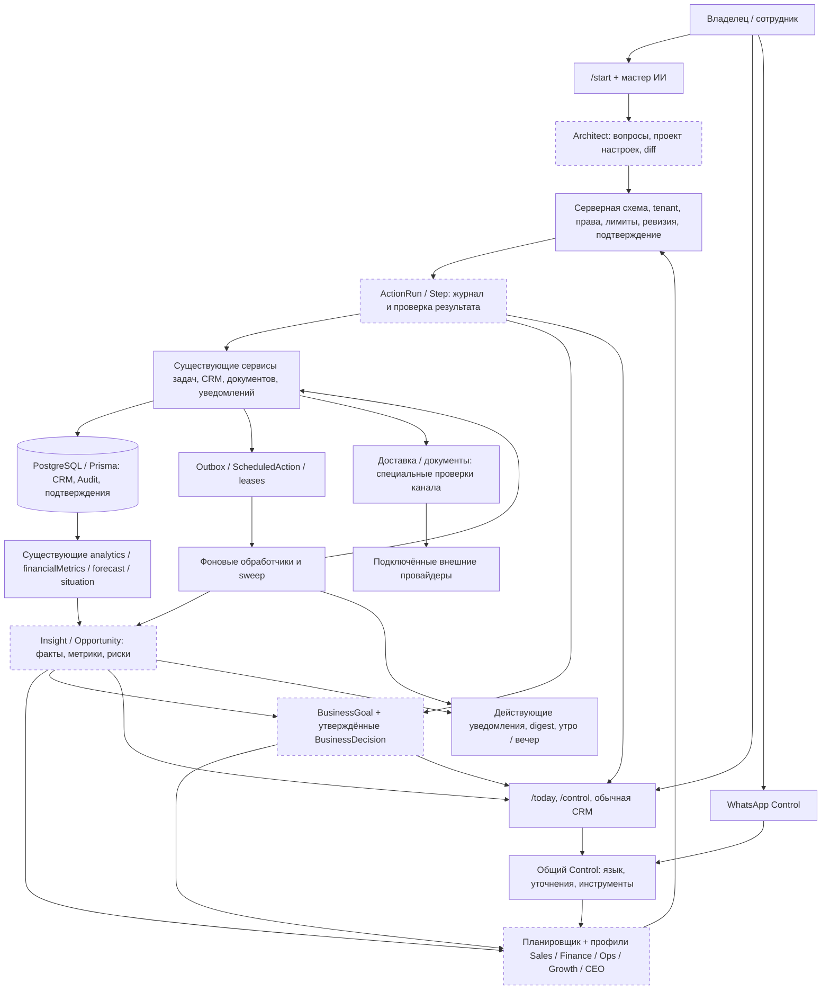

# BasQar → AI Business OS: аудит и план развития

Дата: **30 октября 2026 года**, Asia/Almaty. Формат работы: **исследование, локальные проверки и документация; без реализации новых функций**.

Основание: приложенное задание «АУДИТ И РАЗВИТИЕ BASQAR В AI BUSINESS OS». Проверен текущий рабочий каталог, а не только опубликованный коммит. Ветка: `codex/stage9-release`; HEAD: `85ca15135f64ce2f7d54b129da8c3703001cae7d`. До аудита в каталоге уже были незакоммиченные изменения этапа 9.3, включая оценку рисков сделки. Они учтены как **локальная реализация**, а не как подтверждённая функция рабочего сайта.

Все пути к существующему коду ниже приведены относительно корня репозитория. Предлагаемые файлы и модели явно обозначены как новые. Нумерация этапов **A0–A12** относится к этому плану и не заменяет прежние этапы проекта 7–9.

**Обновление 01.11.2026:** по отдельному поручению пользователя A0 реализован и проверен локально. Итоги, проверки и условия выпуска — [приёмка A0](output/documents/BasQar-A0-acceptance-2026-11-01.md). Основной текст ниже сохраняет исходный срез аудита от 30 октября; утверждения о выявленных дефектах не означают, что они остались после A0. Рабочий сервер этим этапом не обновлялся.

**Продолжение 01.11.2026:** A1 реализован и проверен локально: общий подтверждённый план, четыре разрешённых действия, пошаговый результат, отмена и история. Проверки и ограничения выпуска — [приёмка A1](output/documents/BasQar-A1-acceptance-2026-11-01.md).

**A2, 01.11.2026:** реализован локальный помощник подготовки проекта настройки по ограниченной анкете и проверенным шаблонам. Сравнение с действующими настройками, уточнения, сохранение/восстановление и контроль ревизии. На этапе A2 рабочие настройки ещё не применялись. Проверки и границы — [приёмка A2](output/documents/BasQar-A2-acceptance-2026-11-01.md).

**A3, 01.11.2026:** добавлено подтверждённое применение подготовленной версии: точный список изменений, очередь ActionRun, атомарное сохранение локальных настроек, отмена ожидания, история и оставшиеся ручные шаги. Повторы, конфликты и сбои не создают частично применённую конфигурацию. Действующие промпты, сделки, знания, роли и подключения сохраняются. Проверки и ограничения выпуска — [приёмка A3](output/documents/BasQar-A3-acceptance-2026-11-01.md).

**A4, 02.11.2026:** реализованы шесть правил доказательных бизнес-выводов, порционный фоновый расчёт, защита от устаревших оснований, отметки сотрудника и история. В Control добавлен раздел с фактами, пояснениями и переходом к исходной записи. Проверены серверные сценарии, сборка, мобильный и настольный вид, изменение срока задачи и снятие просрочки. Подробности и ограничения — [приёмка A4](output/documents/BasQar-A4-acceptance-2026-11-02.md). Рабочий сервер не обновлялся.

**A5, 02.11.2026:** реализованы коммерческие возможности по трём основаниям: запрос предложения без зарегистрированной отправки, поздняя стадия без следующего шага и необработанное обращение. Причины одной сделки объединены. Внутренняя задача создаётся через подтверждённый ActionRun, с защитой от дублей и записью фактического результата в историю клиента. Проверено локально: 113 серверных и 98 веб-сценариев, типы и сборка. Визуальная проверка A5 и Linux/PostgreSQL/Docker остаются открытыми; публикации не было. Подробности — [приёмка A5](output/documents/BasQar-A5-acceptance-2026-11-02.md).

**A6, 02.11.2026:** добавлены измеримые бизнес-цели в Control: единый план продаж, сокращение просрочек и скорость первого ответа. Период, ответственный, исходный показатель, фактический прогресс, история измерений и изменений, связи с Task/ActionRun, ежедневные проверки и архив. Прогресс не рассчитывается моделью, пустые/неполные данные не превращаются в успех. Проверено локально: 114 серверных сценариев в 9 файлах (один файл повторён после исправления тестовой изоляции), 105 веб-проверок, типы и сборка. Визуальная проверка и Linux/PostgreSQL/Docker остаются открытыми; публикации не было. Подробности — [приёмка A6](output/documents/BasQar-A6-acceptance-2026-11-02.md). На момент завершения A6 следующим этапом была память решений A7; её актуальный статус приведён ниже.

**A7, 02.11.2026:** реализованы память решений, предпочтений и гипотез, явное утверждение, замена конфликтующего решения, отзыв и удаление по сроку хранения. Основания Goal/Insight/ActionRun проверяются с учётом доступа; контекст ограничен. Планы содержат ссылки на версии и перепроверяют их перед каждым шагом. Исправлен выбор измерения цели при одинаковом времени разных версий. Проверено локально: 138 серверных сценариев в 9 файлах, 112 веб-проверок, типы и сборка. Визуальная проверка и Linux/PostgreSQL/Docker остаются открытыми; публикации не было. Автоматическое использование памяти в советах чата входит в A9. Подробности — [приёмка A7](output/documents/BasQar-A7-acceptance-2026-11-02.md). На момент завершения A7 следующим этапом был A8; его актуальный статус приведён ниже.

**A8, 02.11.2026:** реализован ограниченный контроль первого ответа: новые заявки → рабочий календарь → внутренняя задача и напоминание → одна передача руководителю → проверка фактического ответа. Режим suggest по умолчанию, auto — только с разрешения владельца; распределение fixed/round-robin/нагрузка, недоступность сотрудников, остановка при ручном изменении, лимиты и защита от повторов. Добавлены настройки, история задач/клиента и ActionRun. Проверено локально: 251 актуальный уникальный серверный сценарий в выбранных 14 файлах (249 общим прогоном, A8 повторён после двух дополнительных тестов: 36/36), 118 веб-проверок, миграции, типы и сборка. Браузер недоступен; визуальная и Linux/PostgreSQL/Docker-приёмка открыты, публикации не было. Подробности — [приёмка A8](output/documents/BasQar-A8-acceptance-2026-11-02.md). Следующий этап — A9; A9–A12 ещё не завершены.

**A9, 02.11.2026:** реализован первый ограниченный вариант разбора бизнеса в существующем Control: пять направлений, реальные данные и ссылки, выборка целей/выводов/утверждённых решений, уточнение неоднозначных запросов и внутренняя задача через подтверждённый A1. Без новых вызовов модели; максимум 5 чтений и 7 карточек, бюджет чтения 30 секунд. История показывает фактический прогресс, создание задачи не считается достигнутым бизнес-результатом. Проверено локально: 215 актуальных уникальных серверных сценариев в 12 файлах, 124 веб-проверки, типы и сборка. В Chrome пройден путь от анализа до подтверждения и результата «задача создана»; мобильный вид и финальный снимок остались непроверенными после отключения браузера. Свободное многошаговое планирование и причинный анализ продаж в этот вариант не входят. Публикации не было; Linux/PostgreSQL/Docker-приёмка остаётся открытой. Подробности — [приёмка A9](output/documents/BasQar-A9-acceptance-2026-11-02.md). Следующая работа по коду — A10; A10–A12 ещё не выполнены. Предыдущая строка A8 описывает статус на момент его завершения.

**A10, 02.11.2026:** реализованы компактная главная страница с ближайшим шагом, четырьмя показателями CRM и общей строкой Control, выборка актуальных выводов/личных планов/целей, расширенные утренние и вечерние сводки. Подробная очередь сохранена в раскрываемом блоке, ошибки и проблемы подключений видны отдельно. Сотрудник получает только личную работу. Права проверяются повторно; устаревшие измерения и сбои не выдаются за достигнутые цели или отсутствие проблем. Плановая сводка в тихие часы того же номера пропускается, прямые команды не задерживаются. Новых таблиц и вызовов модели для обзора/сводок нет. Локально прошли 199 актуальных уникальных серверных сценариев в 9 файлах, 131 веб-проверка, типы всех настроенных пакетов и сборка с прежним бюджетом. Визуальная desktop/mobile/keyboard-приёмка и Linux/PostgreSQL/Docker-проверки остаются открытыми; публикации не было. Подробности — [приёмка A10](output/documents/BasQar-A10-acceptance-2026-11-02.md). Следующий функциональный этап — A11, проверки выпуска A12 продолжаются отдельно. Строки A0–A9 выше фиксируют историческое состояние на момент завершения каждого этапа.

**A11, 02.11.2026:** реализован первый ограниченный сценарий проверок улучшений — время от создания задачи «КП» до подготовки отправки. В Control доступны черновик, выбор группы и одинаковых периодов, связь с задачей внедрения/целью/общим решением, просмотр исходной выборки и отдельное подтверждение. После подтверждения условия неизменны; сохраняются промежуточные/итоговые измерения, причины остановки и изменения условий. Малая или неполная выборка, изменения исходных записей, несопоставимые условия и неподтверждённое внедрение не выдаются за успешный эффект. Всегда causal=false; автоматической правки ИИ, воронки, задач или отправок нет. Новые таблицы включены в обязательные миграции. Локально прошли 135 уникальных серверных сценариев в 7 файлах, 140 веб-проверок, типы и сборка с прежним бюджетом. Визуальная desktop/mobile/keyboard-приёмка и настоящая Linux/PostgreSQL-проверка не выполнены. Публикации не было. Подробности — [приёмка A11](output/documents/BasQar-A11-acceptance-2026-11-02.md). Следующая работа — A12, эксплуатационная приёмка и постепенное включение; предыдущие строки описывают историческое состояние этапов.

## 1. Текущее состояние BasQar

### Заключение

**BasQar уже существенно шире обычной CRM с чат-ботом.** В коде есть обработка обращений, ИИ-ответы, извлечение фактов из переписки, предложения изменений CRM, подтверждения, автоматическое сопровождение сделок, контроль ситуаций, фоновые задания, уведомления, финансовые расчёты и естественно-языковой Control в веб-интерфейсе и WhatsApp.

**Полноценная AI Business OS пока не собрана.** Основной разрыв — между обнаружением проблемы, управленческим решением, выполнением нескольких действий и измерением результата. Эти части существуют в разных предметных сервисах, но общей модели управленческого плана, бизнес-цели, доказательного вывода и долгосрочного решения ещё нет.

Рациональный путь: сохранить CRM, стек, очереди, права и существующие исполнители; добавить согласованный слой планирования, доказательств и контроля исполнения. Пять самостоятельных ИИ-систем, новая CRM, отдельный брокер сообщений и генератор отраслевых приложений для этого не требуются.

### Архитектура

| Слой | Реальная реализация | Значение для развития |
|---|---|---|
| Веб | `apps/web`: React, TypeScript, Vite; страницы `/start`, `/today`, `/control`, CRM, настройки и платформа администратора | Расширять текущие страницы и компоненты; не создавать вторую навигацию |
| API | `apps/api`: Express, TypeScript, предметные сервисы; регистрация маршрутов в `src/app.ts` | Валидация и права должны оставаться на сервере; модель не получает прямой доступ к Prisma |
| Данные | `packages/db`: Prisma, PostgreSQL; PGlite для локальной работы и изолированных тестов | Использовать существующие транзакции, tenant-ограничения, индексы и аддитивные миграции |
| Контракты | `packages/contracts`, `packages/api-client` | Общие схемы запросов/ответов, состояния действий и типы доказательств |
| Фоновые процессы | `startBackgroundJobs` запускается из API и доступен через `apps/worker` | Автоматизация уже не зависит от открытого браузера; важны общие лимиты и координация процессов |
| Очереди | `OutboxEvent`, `ScheduledAction`, аренды заданий, `OutboundOperation`, специализированные очереди Control и рассылок | Переиспользовать; улучшить конечные состояния, пределы повторов и наблюдаемость |
| ИИ | Единый клиент LLM, настройка модели/ключей, база знаний, политики, учёт ресурсов, отдельные сценарии анализа и ответа | Основа общего оркестратора уже есть; необходимы ограниченный контекст и проверяемые результаты |
| Мобильный клиент | `apps/mobile`: Expo / React Native; часть функций, отдельные экраны | Это не полный функциональный аналог веб-версии; мобильная веб-версия и native-приложение — разные контуры проверки |
| Развёртывание | Dockerfile, `render.yaml`, GitHub Actions для PostgreSQL и контейнера | Конфигурация существует; успешный деплой текущего рабочего дерева этим аудитом не подтверждён |

API содержит 462 регистрации маршрутов, найденные статическим поиском литеральных `app.get/post/...`. Это не полная спецификация API: динамические маршруты считаются иначе. Найдено одно точное повторение пары «метод + путь», описанное в разделе 5.

### Что реально проверено

| Проверка | Результат этого аудита | Граница результата |
|---|---|---|
| `npm run typecheck` | Успешно, код выхода 0 | Проверка типов workspace, включая mobile; не запуск на телефоне |
| `node scripts/test-api.mjs` | **187/187 файлов, 1 989/1 989 тестов**, ошибок/пропусков нет | API и контракты, отдельная PGlite-база на файл; внешние провайдеры отключены |
| `npm run test --workspace=@creolab/web` | **81/81 тест**, код выхода 0 | Автоматические тесты веб-кода; не визуальный обход всех экранов |
| `npm run build --workspace=@creolab/web` | Успешно, код выхода 0 | Начальный JS 1 099,93 kB, gzip 278,84 kB; есть предупреждение Vite о крупном чанке |
| Трассировка выполнения | UI → API → сервисы → модели → фоновые обработчики для ключевых сценариев | Статическое исследование и локальные тесты, не проверка рабочих клиентских данных |

Логи: `/tmp/basqar-ai-os-types-2026-10-30.log`, `/tmp/basqar-ai-os-api-full-2026-10-30.log`, `/tmp/basqar-ai-os-web-2026-10-30.log`, `/tmp/basqar-ai-os-build-2026-10-30.log`. Это временные артефакты; итоговые результаты сохранены в данном отчёте.

Контроль сохранности: SHA-256 **2 212 файлов**, зафиксированных до аудита, сверены после проверок и подготовки отчёта — изменённых и исчезнувших файлов нет. Существующие незакоммиченные изменения сохранены. Новый результат этого запуска — данный Markdown-отчёт; исходный рабочий код не редактировался.

**Не выполнялись:** production-операции, отправки клиентам, реальные платежи, операции ИС ЭСФ, production-миграции, новый запуск Linux/PostgreSQL/Docker CI, визуальная проверка браузером, проверка актуальных уязвимостей зависимостей, нагрузочный прогон и оценка реальных ответов оплачиваемой модели. Работоспособность внешних аккаунтов и текущий статус Render не подтверждались. Ранее сообщённое пользователем окончание подписки Render нельзя считать исправленным по результатам локальных тестов.

### Условия доступности

Наличие функции в коде не означает её доступность каждой компании. Действуют статус tenant, членство и права сотрудника, возможности тарифа, лимиты ресурсов, настройка модели, опубликованный промпт/знания, режим автоматизации, глобальная пауза, состояние канала и отдельные платформенные переключатели. ИС ЭСФ имеет самостоятельный платформенный запрет; автоматизация переписки дополнительно учитывает клиента, источник, расписание и передачу сотруднику.

## 2. Матрица возможностей

Обозначения: ✅ — подтверждено кодом и локальными тестами; 🟡 — реализована часть целевого сценария; 🔵 — работает в исследованном контуре, требуется улучшение; ❌ — целевой механизм не найден; ⚪ — в этом аудите проверить нельзя. **✅ не означает подтверждение production.** Обозначения E01–E23 соответствуют группам доказательств в разделе 3. Приоритеты: P0 — до расширения автономности; P1 — первая версия; P2 — следующий выпуск; P3 — долгосрочное развитие.

| Возможность | Статус | Что уже существует | Что отсутствует | Что доработать | Приоритет |
|---|---|---|---|---|---|
| Контакты, обращения, сделки, задачи, история | ✅ | Связи, права, статусы, активности, история этапов [E03] | Общий управленческий план поверх них | Переиспользовать предметные API | P1 |
| Пошаговый запуск компании | 🔵 | Выбор канала, этапы, проверка фактического первого обмена [E01] | Настройка CRM по свободному описанию бизнеса | Расширить `/start` | P1 |
| Мастер ИИ-менеджера | 🔵 | Анкета, цели диалога, генерация правил, черновик, публикация, проверка, версии [E02] | Конфигурация всей компании | Использовать как часть Architect | P1 |
| Консультации, продажи, поддержка, запись, заказ | 🟡 | Ролевые сценарии ИИ и предварительная заявка на запись/товар/еду [E02, E04] | Универсальное подтверждение слотов, остатков, исполнения заказа | Ясно отделять заявку от подтверждённой операции | P1 |
| Знания из PDF/изображений/URL | 🔵 | Извлечение, предпросмотр и ручная публикация [E05] | Поиск релевантных фрагментов в runtime, полная история источника, обновление сайта | Ограничение контекста и происхождение сведений | P0/P1 |
| AI Architect целиком | 🟡 | Onboarding + мастер ИИ + настройка воронки [E01–E03] | Валидируемый пакет настроек с diff и единым подтверждением | Расширить существующий мастер | P1 |
| Динамическое распределение заявок | ❌ | Модель `RoutingRule`, назначения и фиксированный ответственный процесса [E06] | Исполнение правил `RoutingRule`, очередь/round-robin/нагрузка | Ограниченный серверный механизм правил | P2 |
| ИИ извлекает факты и предлагает изменения CRM | ✅ | Evidence, версии, режимы, подтверждение, ограниченная отмена [E04] | Общая связь с управленческими целями | Подключить к общему журналу исполнения | P1 |
| Автоматическое создание сделки | 🔵 | Off/suggest/auto, проверка интереса, защита от дубликата [E07] | Единый жизненный цикл коммерческой возможности | Сохранить текущую логику, добавить связь с Insight | P1 |
| Следующий шаг и документы сделки | 🔵 | Сопровождение по фактам документов/платежей, задачи и уведомления [E07] | Общий план с проверкой всех зависимых шагов | Общая модель исполнения | P1 |
| Риски сделки | 🔵 | Сигналы, доказательства, предложение задачи, подтверждение [E08] | Полный обзор сверх первых 200 сделок | Полные агрегаты и постраничный список; выпуск локальных изменений отдельно | P0/P1 |
| Ситуации и SLA | ✅ | Эпизоды, расписание, история, snooze, повторное открытие [E09] | Универсальная цепочка эскалаций | Расширять эпизоды, не создавать вторые инциденты | P1 |
| Серверная автоматизация без браузера | ✅ | Outbox, планировщик, sweep и leases [E10] | Общая конечная политика ошибок и бюджет автоматизации | Устранить F01/F02, затем развивать | P0 |
| Повторный контакт с клиентом | 🟡 | Политика, расписание, попытки, stop по новым сообщениям [E11] | Одинаковое исполнение во всех каналах | Матрица возможностей каналов и безопасные адаптеры | P2 |
| Автоматическое перераспределение по SLA | ❌ | Обнаружение задержки, назначение, уведомления [E06, E09] | Настраиваемая разрешённая цепочка reassignment | Отдельный ограниченный сценарий Autopilot | P2 |
| Задачи из естественного языка | ✅ | Разбор, выбор клиента, черновики, группы, сроки, история [E12] | Межмодульный стратегический план | Использовать действующий исполнитель | P1 |
| Подтверждение внешней отправки | ✅ | Снимок содержания, lease, сверка и неопределённый результат [E12] | Универсальная оболочка всех типов действий | Сохранить специализированные гарантии | P0/P1 |
| Control в вебе и WhatsApp | 🔵 | Общие команды, естественный язык, уточнения, история; меню необязательно [E13] | Многошаговый план с прогрессом и итогом | Расширить Control до AI CEO | P1/P2 |
| Общий AI Action Engine | 🟡 | Несколько действующих механизмов прав/подтверждения/исполнения [E04, E12–E14] | Единые ActionRun/Step, postconditions и остановка плана | Адаптеры над существующими сервисами | P0/P1 |
| Права, изоляция, аудит | ✅ | Tenant-предикаты, роли, ControlAccess, история, серверные проверки [E14, E22] | Гарантии для ещё не созданных OS-модулей | Распространить существующую модель на каждый новый инструмент | P0 |
| Аналитика CRM и команды | 🔵 | Периоды, тренды, когортные/событийные расчёты, drilldown [E15] | Общий проактивный набор выводов и экономичный snapshot | Переиспользовать расчёты | P1 |
| Финансовые показатели | 🔵 | Подтверждённые поступления, счета, сделки, валюты и ограничения видимости [E15] | Полная экономика бизнеса без данных о расходах/себестоимости | Явно указывать доступные данные и смысл метрик | P1 |
| Прогноз продаж | 🔵 | Детерминированный прогноз, минимальная выборка, диапазон, backtest [E16] | Сезонность и статистически калиброванная вероятность | Корректно маркировать ограничения | P1/P2 |
| Business Intelligence Engine целиком | 🟡 | Ситуации, риски, аналитика, прогноз [E08–E10, E15–E16] | Единый Insight: факт/метрика/прогноз/гипотеза/рекомендация | Общий доказательный слой | P1 |
| Контроль достоверности текста аналитика | 🟡 | Ограниченный snapshot, промпт, безопасные внутренние ссылки [E17] | Проверка каждого утверждения по metric/evidence ID | Числа из кода, текст модели — пояснение | P0/P1 |
| Opportunity Engine | 🟡 | Кандидат сделки, незакрытый следующий шаг, близость к продаже [E07–E08] | Повторные покупки, dormant-сегменты, outcome, дедупликация оценки потенциала | Использовать Insight с типом opportunity | P1/P2 |
| AI CEO | 🟡 | Control получает данные и выполняет отдельные команды [E13–E14] | Составление, подтверждение и сопровождение бизнес-плана | Единый планировщик в Control | P2 |
| Sales/Finance/Ops/Growth/CEO-профили | 🟡 | Предметные инструменты и права уже есть [E07–E17] | Общие профили контекста/инструментов/бюджета | Один оркестратор, несколько профилей | P2 |
| Цели компании | 🟡 | Месячный план продаж, цель диалога и цель сопровождения сделки [E02, E07, E16] | Общая цель с baseline, KPI, владельцем, инициативами и историей | Небольшой слой BusinessGoal | P1/P2 |
| Долгосрочная Business Memory | 🟡 | Знания, контактные факты, активности, аудит, сессии [E18] | Утверждённые управленческие решения с актуальностью и сроком хранения | Структурированная память решений | P1/P2 |
| Self-Improving Business | ❌ | История, длительности, сравнение периодов, проверка ИИ [E15–E18] | Контролируемые эксперименты с гипотезой и оценкой эффекта | После накопления достоверных результатов | P3 |
| Утренние/вечерние сводки | 🔵 | Планировщик, объединение, дедупликация, настройки [E19] | Общие цели, результаты планов и рекомендации | Расширить содержание; сохранить ограничения канала | P1 |
| Срочные уведомления и защита от спама | ✅ | Релевантность, тишина, интервалы, digest, повторная проверка прав [E19] | Новые виды бизнес-выводов | Добавлять категории в действующую систему | P1 |
| Главная OS-панель | 🟡 | `/today`, `/control`, аналитика и блоки продаж [E09, E13, E15] | Общие Goals/Actions/Intelligence на основе единых данных | Постепенное развитие существующей главной | P1/P2 |
| Учёт ИИ-ресурсов | 🔵 | AIUsage, кредиты, тарифы, резервирование и лимиты [E20] | Бюджет плана/tenant по времени и стоимости, общий лимит параллелизма | Добавить поверх текущих тарифов | P0/P1 |
| Адаптивный выбор модели и ограниченный retrieval | ❌ | Выбор модели в настройках, кэш конфигурации [E05, E20] | Выбор по сложности и выборка релевантных знаний | Начать с лимитов и обычного поиска, не с новой БД | P1/P2 |
| Проверка интеграций | 🟡 | Настройки, локальные проверки, события и ошибки [E21] | Единая свежесть/сквозной сигнал провайдера | Не выдавать конфигурационный HEALTHY за E2E | P0/P1 |
| Документы, АВР, счета, ЭСФ | 🔵 | Создание, файлы, подтверждения, подпись/статусы [E21] | Общая интеграция в план действий | Только черновики в первой версии OS | P1 |
| Рабочие Freedom Pay, ИС ЭСФ, каналы компаний | ⚪ | Адаптеры, флаги и тесты присутствуют [E21] | Подтверждение конкретных рабочих подключений в этом аудите | Отдельная контролируемая приёмка | Перед production |
| Kaspi как автоматический эквайринг | ❌ | Опциональный ручной сценарий [E21] | Подтверждённый автоматический адаптер | Не включать в обещания OS | Отдельная интеграция |
| Native-приложение | 🟡 | Авторизация, некоторые списки/действия [E23] | Полная функциональная и эксплуатационная готовность | Убрать демонстрационные значения входа, отдельно принимать релиз | P2 / до mobile-релиза |
| Legacy AI sandbox | 🟡 | API и запись `AIExecution` [E18] | Реальный вызов модели именно в этом endpoint | Не использовать для доказательства качества ИИ | P1 |
| Выпуск текущего рабочего дерева | ⚪ | CI-конфигурация и локальные успешные проверки | Свежая проверка PostgreSQL/Docker/деплоя | Отдельный release gate | До публикации |

## 3. Анализ существующего кода

### E01. Первоначальная настройка

- **Цепочка:** `apps/web/src/pages/GettingStartedPage.tsx`, `components/OnboardingWizard.tsx` → GET/PATCH `/api/v1/workspace/onboarding` → `apps/api/src/services/onboardingService.ts` (`getOnboarding`, `updateOnboarding`). Контракт: `packages/contracts/src/onboarding.ts`.
- **Данные:** настройки Tenant, состояние интеграции/канала, опубликованная конфигурация ИИ, сообщения и события проверки. Завершение маршрута проверяет фактические условия, а не только посещение страницы. Обновление защищено транзакцией и блокировкой Tenant.
- **Фон/зависимости:** подключение канала и первое обращение обслуживают действующие интеграции. Сам onboarding не создаёт отдельный воркер.
- **Проверка:** `apps/api/src/onboarding.test.ts`, проверки регистрации и workspace. Хорошая основа Architect, но свободный бизнес-бриф ещё не превращается в пакет настроек всей CRM.

### E02. Профессиональная настройка ИИ

- **Цепочка:** `pages/AiManagerSetupPage.tsx`, `components/AiManagerSetupChecks.tsx`, административный `pages/platform/PlatformCompanyAiManager.tsx` → `/api/v1/settings/ai-manager` и `/publish`, `/restore`, `/reload`, `/preview`, `/review` → `aiManagerSetupService.ts`.
- **Сборка:** `compileAiManagerDraft` в `packages/contracts/src/aiManagerSetup.ts`; анкета, роль, цель, знания, ограничения, недостающие сведения, сценарии проверки. Доступны консультация, продажа, поддержка и сценарии предварительной записи/заказа.
- **Данные:** `AIConfiguration.limitsJson.aiSetup`, опубликованный промпт, `KnowledgeDocument`; ревизия, fingerprint и блокировка Tenant. Хранятся ограниченные наборы версий и прогонов качества, а не бесконечный журнал. Черновик отделён от опубликованных знаний. Публикация проверяет подготовленные сценарии и человеческую оценку ответа.
- **Фон/зависимости:** предпросмотр использует LLM и лимиты, но не совершает клиентскую отправку; публикация инвалидирует конфигурацию и синхронизирует поддерживаемый канал.
- **Тесты:** `aiManagerSetup.test.ts`, `aiManagerGoals.test.ts`, `aiManagerActivation.test.ts`, `aiManagerPolicy.test.ts`, `aiManagerSaaS.test.ts`. Они не доказывают качество любого будущего ответа живой модели.

### E03. CRM, воронка и процессы

- **Цепочка:** `pages/DealsPage.tsx`, `TasksPage.tsx`, `SettingsPage.tsx` → API сделок/задач и GET/PATCH `/api/v1/workspace/ops` → `domainService.ts`, `contactService.ts`, `dealPipeline.ts`, `dealPipelineSettings.ts` (`savePipeline`, `processSettingsRevision`).
- **Данные:** `Contact`, `ContactMethod`, `Company`, `Inquiry`, `Deal`, `DealStage`, `DealStageHistory`, `Task`, `Agreement`, `Activity`. Не смешивать `Plan` тарифа с отсутствующим планом управленческих действий.
- **Фон:** переходы, новые обращения и изменения документов могут создавать события в существующий outbox. Рабочий календарь — `packages/contracts/src/processCalendar.ts` и сервис `processCalendar.ts`.
- **Тесты:** `workspaceAcceptance.test.ts`, `http.test.ts`, `accessControl.test.ts`, `processCalendar.test.ts`, `dealProcessPolicy.test.ts`. Новая архитектура должна сохранять обычную ручную работу CRM.

### E04. Переписка → факты → изменения CRM

- **Цепочка:** входящее сообщение → `conversationContextQueue.ts` (`enqueueConversationContext`, обработчик задания) → анализ в `llmClient.ts` → `conversationContextApplyService.ts` (`applyAnalyzedConversation`) → карточки CRM. Предложения доступны через `/api/v1/conversations/:id/crm-review`; решение принимает `conversationCrmReviewService.ts` (`reviewConversationCrmChange`).
- **Защита:** `aiAutomationPolicyService.ts` (`decideAutomationPolicy`) и `aiAutomationSettings.ts`: MANUAL/ASSIST/CONFIRM/AUTO, пауза, запрещённые контакты, клиентские/канальные ограничения, ручной режим. Результат модели не равен разрешению на запись. Сверяются revision/controlVersion, сообщение-основание, уверенность и доказательства; ручные изменения защищены.
- **Данные:** сообщения, `ContactFact`, `Activity`, `AuditEvent`, `IdempotencyRecord`, связанные `Task`/`Agreement`. Политика отмены в `conversationProcessReview.ts`: нельзя слепо откатить уже изменённые человеком данные или начатую внешнюю отправку.
- **Предварительные заказы:** анализ записи/товара/еды формирует потребность и предпочтения. Это не бронирование свободного слота, резерв склада, чек или подтверждённый заказ кухни.
- **Тесты:** `conversationContext.test.ts`, `conversationContext.situation.test.ts`, `conversationProcessReview.test.ts`, `conversationProcessProposal.test.ts`, `aiAutomation.test.ts`, `aiIntake.test.ts`.

### E05. Импорт и использование знаний

- **Цепочка:** мастер ИИ → POST `/api/v1/settings/ai-manager/knowledge-preview` → `aiKnowledgeImportService.ts` (`previewAiKnowledgeImport`, `extractKnowledgeFileIsolated`) → предпросмотр → публикация через мастер. Лимиты в `packages/contracts/src/aiKnowledgeImport.ts`.
- **Ограничения:** файл до 10 MiB; изолированная обработка с лимитом памяти и времени. URL — публичная HTTPS-страница, с защитой от обращения к внутренним адресам, ограничением размера/времени. Это не обход авторизации социальной сети, не обход всего сайта и не постоянно обновляемая копия.
- **Runtime:** `tenantAiConfigService.ts` (`getPublishedTenantAiContext`, `buildTenantAiSystemPreamble`) загружает опубликованные `KnowledgeDocument` и составляет общий контекст. Релевантный поиск админского интерфейса сам по себе не означает retrieval при каждом ответе.
- **Пробел:** ограничение размера исходного файла не ограничивает общий объём знаний в запросе к модели. Нужны бюджет токенов, выборка фрагментов, source/version/verifiedAt и обработка противоречий. В `KnowledgeDocument` сейчас нет полноценной модели URL/страниц/фрагментов источника.
- **Тесты:** `aiKnowledgeImport.test.ts`, проверки мастера и tenant-безопасности. Автопубликацию найденного в интернете добавлять нельзя.

### E06. Распределение обращений

- В `packages/db/prisma/schema.prisma` есть `RoutingRule` с `tenantId`, `integrationId`, `kind`, `assigneeMembershipId`, `queueJson`, `priority`; таблица присутствует и в `init.sql`.
- Поиск обращений к `RoutingRule`/`routingRule` во всех `apps` и `packages` выявил схему/инициализацию, **но не исполняющий сервис или UI/API управления этими правилами**. Наличие таблицы не является реализованным автодиспетчером.
- В других процессах уже есть ручное назначение, фиксированный ответственный, проверки действующего членства и видимости. Их следует использовать, а `RoutingRule` — сначала уточнить и валидировать, а не создавать рядом вторую одноимённую сущность.
- Для нового engine нужны тесты справедливости назначения, отсутствующего сотрудника, расписания, права видеть заявку, гонки двух обработчиков и запрета циклической передачи.

### E07. Автоматическое сопровождение сделки

- **Цепочка:** `SalesProcessSettings.tsx` → существующие настройки → `packages/contracts/src/salesProcess.ts` → `salesProcessService.ts` (`considerSalesOpportunity`, внутренний `createSalesDeal`, `reviewSalesProposal`, `enqueueSalesReconcile`) → `salesControlService.ts` (`reconcileSalesDeal`, `sweepSalesProcesses`).
- **Фактический смысл:** off/suggest/auto; цель qualified/meeting/proposal/order/payment. Сделка требует основания в клиентской переписке. Блокировка контакта и проверка существующих сделок предотвращают простое повторное создание; при неоднозначной существующей сделке требуется разбор.
- **Данные:** `Deal`, `DealConversation`, `Activity` с предложением сделки, задачи, документы, подтверждённые платежи. Предложение сделки сейчас не универсальная сущность Opportunity.
- **Фон:** `sales.reconcile`, события подписанного договора/документа и периодический sweep с сохраняемым курсором. Продвижение выводится из сохранённых фактов; достижение цели не означает автоматическое присвоение `won` любой сделке.
- **Тесты:** `salesProcess.test.ts`, `dealProcessPolicy.test.ts`, `financialReporting.test.ts`. Следует сохранить ручные изменения этапа/следующего шага и различие заявки, заказа, оплаты и результата продажи.

### E08. Риски и действия по сделкам — текущие локальные изменения 9.3

- **Цепочка:** `SalesControlPanel.tsx`, `DealRiskDetails.tsx`, `SalesForecastCard.tsx` → GET `/api/v1/sales/control`, POST `/api/v1/sales/deals/:id/risk-task` → `salesControlService.getSalesControl`, `dealRiskPolicy.assessDealRisk`, `dealRiskService.acceptDealRiskTask`. Контракт: `packages/contracts/src/dealRisk.ts`.
- **Содержание:** объяснимые сигналы, ссылки на факты, задача с ответственным/сроком, fingerprint состояния, проверка прав и защита от повтора. Для WhatsApp есть `controlSalesRiskPresentation.ts`.
- **Пробел:** `getSalesControl` выбирает 200 сделок **до** сортировки по риску. `total` считает все, а urgent/needsAttention/closeToSale — только выбранный набор. Флаг `limited` есть, но это всё равно не полный обзор компании.
- **Проверка:** `apps/api/src/dealRisk.test.ts`, связанные Control/forecast-тесты прошли в текущем полном прогоне. Отдельные `scripts/deal-risk.test.mjs`/`scripts/sales-forecast.test.mjs` существуют; их отдельный запуск в этом аудите не заявляется. Эти изменения до начала аудита не были зафиксированы в HEAD.

### E09. Ситуации, SLA и рабочая главная

- **Цепочка:** `pages/SituationPage.tsx`, `components/SituationWorkPanel.tsx` → `/api/v1/situation`, `/overview`, `/episode`, `/history`, `/snooze` → `situationService.getSituation`, `situationOverviewService.getSituationOverview`, `situationEpisodeService` (`observeSituationEvidence`, `actOnSituationEpisode`).
- **Данные:** `SituationEpisode`, `SituationEpisodeEvent`, `SituationSnooze`, связанные обращения/сделки/задачи. Эпизод хранит возникновение, доказательство, историю и повторное открытие; исчезновение карточки из выборки не должно само по себе означать решение проблемы.
- **Фон:** `situationSweepService.ts`, `SituationSweepState`: порционный обход источников с сохраняемыми курсорами и tenant-блокировкой. `situationNoticeService.ts` проверяет актуальность и права перед уведомлением.
- **Ограничение:** некоторые чтения также синхронизируют эпизоды/инициализируют стадии. Перед кэшированием нужно разделить read model и reconciliation, сохранив работу фонового sweep.
- **Тесты:** `situation.test.ts`, `situationEpisodes.test.ts`, `situationSweep.test.ts`, `situationPermissions.test.ts`, `situationSweepMigration.test.ts`.

### E10. Фоновая работа и надёжность

- **Запуск:** `apps/api/src/index.ts` и `apps/worker/src/index.ts` вызывают `services/backgroundJobs.ts`. Доступны обработчики ответа, доставки, рассылки, анализа переписки, автоматизации заявки, сопровождения сделки и документов.
- **Данные/координация:** `OutboxEvent`, `ScheduledAction`, `IdempotencyRecord`; `outboxLease.ts`, `scheduledActionLease.ts`. Аренда захватывается атомарно, продлевается и завершается с проверкой владения. `outboxScheduling.ts` разделяет reply/delivery/background и сериализует связанные операции.
- **Проблемы:** общий outbox не ограничивает число повторов навсегда падающего события; неизвестный `event.type` доходит до `processedAt`. Лимиты параллелизма и часть флагов `running` действуют внутри процесса, а не всего кластера.
- **Тесты:** `outboxLease.test.ts`, `outboxScheduling.test.ts`, `scheduledReliability.test.ts`, `aiReplyScheduling.test.ts`. Эти успешные тесты не закрывают обнаруженные отсутствующие сценарии unknown-event/dead-letter.
- **Развёртывание:** в `render.yaml` описан web-сервис; отдельное приложение worker есть в репозитории, но это не доказательство отдельного работающего worker в Render.

### E11. Follow-up и ограничения каналов

- `aiConversationPolicyService.ts` (`processClientFollowUp`) проверяет активность компании, тариф, режим ИИ, паузу, расписание, номер попытки и последнее сообщение-основание. При ответе клиента устаревшее повторное обращение не должно отправляться.
- Текущий исполнитель требует `sellerLeadId` и поддерживаемое legacy-подключение `whatsapp_seller`; иначе останавливается с `no_channel`. Поэтому этот сценарий нельзя считать автоматически поддержанным в WhatsApp QR/Cloud, Telegram, Instagram и webchat только потому, что у них работают обычные ответы.
- Данные: `ScheduledAction`, `OutboundOperation`, переписка и настройки. Delivery и неопределённый результат требуют существующей сверки, а не повторной отправки наугад.
- Связанные тесты: `aiManagerPolicy.test.ts`, `aiReplyDeliveryReview.test.ts`, `scheduledReliability.test.ts`; для расширения нужен отдельный набор тестов по каждому каналу.

### E12. Исполнение задач и групповых команд

- **Цепочка:** `TasksPage.tsx` → `/api/v1/tasks/parse-command`, `/from-command`, `/:id/prepare-execution`, `/confirm-execution`, `/execute`, `/execute-batch`, `/reconcile-delivery`, `/complete-result`, `/next-action` → `aiCommandExecutionService.ts`, `taskExecutionService.ts`, `taskDeliveryService.ts`, `taskResultAnalysisService.ts`.
- `createTaskFromCommand` уже создаёт обычные задачи и дочерние задачи группы, сохраняет исходную команду и черновики. `executeTaskBatch` имеет блокировку, лимит группы и проверку отдельного сценария рассылки. Это существующий исполнитель, а не пустая кнопка интерфейса.
- **Данные:** `Task`, `ExecutionConfirmation`, `ScheduledAction`, журнал активности и записи доставки. Подтверждение связано с содержимым, получателем и файлами; неизвестный результат отправки не равен безопасной ошибке для автоматического повтора.
- **Фон:** `scheduledTaskRunner.ts` заново проверяет доступ подтверждавшего пользователя. Результат работы и следующее предложение обрабатываются отдельно от простой отметки «выполнено».
- **Тесты:** `taskExecution.test.ts`, `scheduledReliability.test.ts`, сценарии HTTP и tenant-access. Универсальный межмодульный план не следует подменять этой группой однотипных задач.

### E13. BasQar Control — каналы, язык и история

- **Веб:** `ControlPage.tsx` → `ControlChatPanel.tsx` → GET/POST `/api/v1/workspace/control/chat` → `controlWebService.ts` → `controlChatService.runControlChatRequest`.
- **WhatsApp:** проверенная `ControlIdentity` → `routeControlWhatsApp` → `ControlChatMessage`/`ControlChatSession` → обработчик и `controlChatDelivery.ts`. Административные команды отделены от клиентских разговоров.
- **Разбор:** `controlChatLanguage.ts`, `controlPeriods.ts`, `controlChatPresentation.ts`: обычные фразы, RU/KK, периоды, уточнение клиента/задачи/исполнителя. Детерминированный разбор выполняется первым, затем допустимый LLM-разбор. **Вызывать меню перед каждой командой уже не требуется.**
- **Контекст/история:** короткая сессия для уточнения; веб-история собирается из событий и сообщений Control, с фильтрацией при изменении доступа. Создание задач проходит обычные сервисы и отражается в истории.
- **Ограничение:** распознаётся отдельная разрешённая команда; это ещё не план «организуй отдел на месяц» с зависимыми шагами и проверкой эффекта.
- **Тесты:** `controlChat.test.ts`, `controlWeb.test.ts`, `controlLanguage.test.ts`, `controlPeriods.test.ts`, `controlReadPrecision.test.ts`, `controlDealQueries.test.ts`.

### E14. Control — безопасные инструменты и подтверждения

- **Сервис:** `aiControlService.ts` (`assertControlPermission`, `needsConfirmation`, `dispatchAction`, `executeResolved`, `confirmControlForIntegration`), контракт `packages/contracts/src/control.ts`. Чтение и запись выполняются через whitelist предметных действий.
- **Данные:** `ControlAccess`, `ControlIdentity`, `ControlConfirmation`, `AuditEvent`, idempotency. Проверяются действующее членство, финансовая/командная видимость, разрешённые действия и источники. Перед подтверждённым выполнением права и состояние проверяются повторно.
- **Важное различие:** общий API Control шире `CHAT_ACTIONS`: включает групповые и высокорисковые операции. Нельзя автоматически отдать весь API новому агенту. Не все существующие низкорисковые записи требуют подтверждения при любой настройке доступа — политика задаётся явно.
- **Пробел:** общего долговечного многошагового плана с checkpoint/postcondition/компенсацией нет. Частичный сбой группы должен отображать фактически выполненные элементы, а не давать разрешение повторить всю группу. Уже существующие `uncertain` и запреты слепого повтора нужно сохранить.
- **Тесты:** `aiControl.test.ts`, `controlChat.test.ts`, `controlReadPrecision.test.ts`, `accessControl.test.ts`.

### E15. Аналитика, финансы и сотрудники

- **Цепочка:** `pages/StatsPage.tsx`, Control → `/api/v1/analytics/dashboard`, `/trend`, `/drilldown` и предметные Control-запросы → `analyticsService.ts`, `analyticsFunnel.ts`, `analyticsTotals.ts`, `analyticsCoverage.ts`, `financialMetrics.ts`.
- **Расчёты:** периоды и сравнения, заявки/клиенты/сделки, история этапов, команда, ответы, финансовые итоги. Когортная конверсия, переходы за период и текущая заполненность этапов имеют разный смысл.
- **Финансы:** `MoneyDecimal`, раздельные валюты, исключение тестовых/архивных сущностей, подтверждённые поступления отдельно от суммы выигранных сделок. Поля с суффиксом `Minor` исторически требуют внимания: в действующих расчётах суммы используются как целые денежные единицы, не следует молча делить их на 100 при новой интеграции.
- **Ограничения:** отсутствие расходов/себестоимости/возвратов/атрибуции нельзя восполнять догадкой. По имеющимся CRM-продажам нельзя достоверно объявить прибыль, cash-flow бизнеса или рекламный ROMI. Часть запросов тяжёлая и не имеет отдельного snapshot для постоянного фонового анализа.
- **Тесты:** `financialReporting.test.ts`, `analyticsPeriods.test.ts`, `controlReadPrecision.test.ts`, `workspaceAcceptance.test.ts`.

### E16. План и прогноз продаж

- **Цепочка:** `SalesForecastCard.tsx`, `lib/salesForecastPresentation.ts`, `controlForecastPresentation.ts` → `salesForecastService.ts` (`getCompanySalesForecast`) → `salesForecastPolicy.ts`; контракт `packages/contracts/src/salesForecast.ts`.
- **Метод:** детерминированная оценка по истории полных месяцев, текущему факту и оставшимся дням. Есть порог достаточности истории/продаж, разделение валют, проверка пригодности данных, историческая проверка прогноза при достаточном объёме.
- **Ограничения:** диапазон на основе истории — не статистический доверительный интервал; это не обученная сезонная модель. Веса стадий — бизнес-эвристика, а не калиброванная вероятность конкретной сделки.
- **Цели:** месячные суммы в `Tenant.settingsJson`/ops `salesPlans`. Это полезный источник для будущего BusinessGoal, но не полный раздел целей с KPI, инициативами и контрольными датами.
- **Тесты:** `salesForecast.test.ts`, `controlForecast.test.ts`, `financialReporting.test.ts`.

### E17. Вопросы к главной и достоверность аналитического текста

- **Цепочка:** `/api/v1/situation/ask` → `situationAskService.ts` (`classifySituationQuestion`, `snapshotFromOverview`) → `llmClient.answerSituationAskWithLlm` либо детерминированный fallback.
- Snapshot ограничивает списки, содержит реальные показатели и прямо указывает, что заполненность этапов не является конверсией. Модель получает инструкцию не выдумывать цифры; URL фильтруются функцией `safeHref`.
- **Пробел:** после генерации проверяется структура/ссылки, но не доказательство каждого числового утверждения в `headline`/`bullets`. Это ограничение проверки, а не обнаруженный случай фактической галлюцинации. В `NODE_ENV=test` LLM-ветка этого сценария отключается, поэтому полный зелёный прогон не измеряет её качество.
- Команды здесь направляются к существующей постановке задач/документам. Не стоит одновременно превращать `/today/ask` и Control в два независимых планировщика: общая строка должна вызывать один оркестратор Control.

### E18. История, память и старые заготовки

- Реальные источники памяти: `ContactFact` с происхождением и ручной блокировкой, `KnowledgeDocument`, версии мастера, `Activity`, `AuditEvent`, `SituationEpisodeEvent`, `ControlChatSession` и `ControlChatMessage`.
- `KnowledgeVersion` и `CatalogItem` также существуют, используются при подготовке компании и чтении каталога. Они не заменяют историю опубликованного мастера и не образуют управленческую память решений.
- `domainService.aiSandbox` по POST `/api/v1/ai/sandbox` создаёт `AIExecution` со статусом completed и возвращает фиксированный демонстрационный текст с входным сообщением. **Именно этот legacy-endpoint не проверяет реальную модель.** Действующий `/settings/ai-manager/preview` — другой, реальный путь; смешивать их нельзя.
- Общая память «утверждённое решение / причина / актуальность / результат / срок хранения» и её отбор в контекст не найдены. Истечение 30-минутной сессии не является политикой удаления исторических сообщений.
- Отдельный контролируемый эксперимент с гипотезой, периодом, выборкой и измерением эффекта не найден. В логах уже есть исходный материал для такого расширения.

### E19. Уведомления и сводки

- **Настройки/UI:** `ControlNotificationsPanel.tsx`, `ControlWhatsAppSettings.tsx` → `/api/v1/workspace/control/notifications` и настройки чата → `controlNotificationService.ts`, `controlChatSettings.ts`, `controlChatDelivery.ts`.
- **Данные:** `ControlNotificationRule`, `ControlNotificationItem`, `ControlNotificationBatch`, обычные `Notification`/`NotificationDelivery`/preferences и Control-сообщения. Поддержаны instant/digest/off, тишина, интервалы, объединение очереди, дедупликация и проверка актуальности получателя.
- **Сводки:** `buildControlBriefings` планирует утро/вечер по часовому поясу и настройкам, не отправляет накопившийся устаревший день после простоя. Плановые WhatsApp-сводки в текущей реализации привязаны к поддержанному QR-сценарию; обычный Cloud-ответ и плановая отправка вне диалога — разные возможности.
- **Расширение:** добавлять цели, результаты ActionRun и рекомендации, а не создавать второй планировщик. Личные Telegram-уведомления сотрудника и Telegram-бот компании — отдельные существующие сценарии, их не объединять по названию канала.
- **Тесты:** `controlNotifications.test.ts`, `controlChat.test.ts`, проверки прав, доставки и scheduled reliability.

### E20. Модели, ресурсы и расходы

- `llmClient.completeChat`, `runtimeSettings.getEffectiveLlmConfig`, `aiUsageService.recordAiUsage`, `billingResourceService.ts`, `entitlementService.ts`, `packages/contracts/src/entitlements.ts` образуют действующий слой вызова и учёта.
- Перед вызовами проверяются доступность функции и ресурсы; есть учёт AIUsageEvent/модели/токенов/задержки, ресурсный ledger, дедупликация по request ID и транзакционные блокировки tenant/usage. Таймауты и ограничения выхода уже существуют.
- **Недостающее:** бюджет многошагового плана, ограничение суммарного количества модельных вызовов на решение, выбор модели по сложности, общий tenant concurrency limit и автоматическая отмена повторного анализа неизменившегося snapshot.
- Кэш конфигурации в `runtimeSettings.ts` локален процессу. При разделении API/worker важен новый номер конфигурации и свежая проверка stop-флага перед действиями, а не только invalidation локальной Map.
- Есть риск семантики cached tokens: `recordAiUsage` складывает input-cost и cached-input-cost, а `llmClient` передаёт `prompt_tokens` и `cached_tokens` раздельно. Если первый показатель провайдера уже включает второй, оценка расходов завышается. Требуется проверка контракта каждого адаптера и fixture; **ошибка реального списания клиентских денег этим аудитом не установлена**.
- Тесты: `billingResourcesV4.test.ts`, `billingAiManager.test.ts`, `billingSaas.test.ts`, тесты настроек и безопасности ИИ. Текущие тарифы менять не требуется.

### E21. Интеграции, документы и внешние условия

- **UI/API:** `IntegrationsPage.tsx`, `DocumentsPage.tsx`, `DealDocumentsPanel.tsx`, `EsfIntegrationPage.tsx`, административные настройки. `integrationCatalogService.ts`, `platformIntegrationService.ts`, `aiChannels.ts`, `channelDeliveryService.ts` и отдельные адаптеры обслуживают подключения.
- Конфигурационный статус `HEALTHY` может выводиться из сохранённого статуса/последнего события без гарантии его свежести. `runIntegrationHealthCheck` не является универсальной тестовой отправкой через провайдера. Для OS необходимы `checkedAt`, возраст последнего успешного события, причина деградации и отдельное «не проверено».
- **Документы:** `/api/v1/documents/from-command`, документы сделки и `/api/v1/electronic-documents/...` → `documentCommandService.ts`, `documentDraftService.ts`, `documentWorkflow.ts`, `legalDocuments.ts`. Черновик, подписанный документ и принятый внешним порталом документ — разные состояния.
- **ИС ЭСФ:** `esfAvailability.ts` проверяет актуальный платформенный feature flag через БД; запрет скрывает/закрывает функциональность. Дополнительно действуют режим провайдера, Kalkan/NCALayer и процедура подписи/отправки. Даже наличие разрешающих env в blueprint не означает включение для клиента.
- **Платежи:** `services/billing/freedomPayProvider.ts`, `services/billing/config.ts`, связанные checkout/ledger-процессы. Подписи и callbacks проверяются локальными тестами; текущий режим мерчанта/банк ими не подтверждается. Kaspi в исследованной конфигурации имеет только отдельно включаемый ручной сценарий.
- **Тесты:** `telegramCompany.test.ts`, `instagramOAuth.test.ts`, `channelAi.test.ts`, `websiteForms.test.ts`, `esfAvailability.test.ts`, `billingProvider.test.ts`, `billingCheckout.test.ts` и HTTP/billing-сценарии. Возможность создавать АВР/ЭСФ локально не подтверждает успешный обмен с рабочим ИС ЭСФ.

### E22. Изоляция, права и обновление схемы

- `apps/api/src/lib/access.ts`: `requireTenant`, проверки membership, tenant/role/visibility predicates. `productionSecurity.ts` проверяет критические production-настройки. Новые инструменты обязаны использовать эти проверки, в том числе при фоновой обработке.
- Значительная часть ссылок усилена составными ключами с tenantId. Общая Row-Level Security PostgreSQL в исследованной схеме не обнаружена: нельзя рассчитывать, что БД исправит пропущенный tenant-фильтр нового агрегата или кэша.
- `packages/db/src/client.ts` и `schemaPatches.ts` применяют существующие аддитивные SQL-патчи, с advisory lock и отдельными механизмами контрольных сумм. Новая Prisma-модель без соответствующей миграции для живой PostgreSQL/PGlite недостаточна.
- `.github/workflows/release-acceptance.yml` содержит отдельные PostgreSQL/контейнерные проверки; `scripts/test-api.mjs --postgres` создаёт изолированные базы, а не тестирует на рабочем `DATABASE_URL`.
- Тесты: `securityAuth.test.ts`, `securityProduction.test.ts`, `securityHardening.test.ts`, `securityTenant.test.ts`, `securityMedia.test.ts`, `accessControl.test.ts`, `schemaPatches.test.ts`. Наличие тестов не заменяет review каждой новой capability.

### E23. Интерфейс, native-клиент и документация

- `apps/web` уже содержит навигацию, общие карточки, mobile-стили, формы настроек, подтверждения и ошибки. OS должна использовать их, а не прятать обычные списки CRM за обязательным чатом.
- Начальный JS почти достиг существующего бюджета 1 100 kB; новые крупные панели лучше загружать по маршруту. Build успешен, но запас по несжатому бюджету минимален.
- `apps/mobile/app/today.tsx` использует API, но часть действий отправляет продолжать работу в вебе; задачи имеют ограниченный набор операций. В `apps/mobile/app/index.tsx` обнаружены предзаполненные демонстрационные данные входа. Их нужно убрать до распространения native-приложения; содержимое учётных данных здесь не публикуется.
- README содержит устаревшие утверждения о роли внешнего ИИ/WhatsApp и локальных портах. Это документационный долг; наличие описания старого сценария не опровергает нынешний код native-каналов.

## 4. Что не нужно разрабатывать повторно

1. **CRM и её таблицы:** контакты, заявки, сделки, задачи, документы, активности и история этапов.
2. **Мастер настройки ИИ:** роли, анкета, сборка промпта, публикация, тестирование и восстановление версии.
3. **Импорт материалов:** извлечение из файлов/страницы, предпросмотр и ручное утверждение знаний.
4. **Control и отдельный веб-чат:** естественный язык, уточнения, права, инструменты, подтверждения и WhatsApp-транспорт уже есть.
5. **Обработчики задач:** создание, назначение, завершение с результатом, черновики и подтверждённая доставка.
6. **Подтверждения и защита повторов:** использовать текущие ControlConfirmation, ExecutionConfirmation, fingerprints, leases и delivery states через адаптеры.
7. **Ситуации:** SituationEpisode остаётся владельцем жизненного цикла инцидента. Insight должен ссылаться на эпизод, а не создавать второй независимый инцидент.
8. **Сопровождение продаж:** существующие правила создания сделки, следующего шага и сверки документов/поступлений.
9. **Аналитические формулы:** периоды, валюты, подтверждённые платежи, когортные расчёты и прогноз — единый источник метрик для UI и ИИ.
10. **Рабочий календарь:** не считать сроки в новом агенте другим способом.
11. **Очереди/планировщик:** сначала расширить outbox и ScheduledAction. Новый брокер — только при измеренной необходимости.
12. **Уведомления:** тихие часы, digest, утро/вечер, приоритеты и актуальность получателя.
13. **Тарифы и ресурсы:** сохранить entitlement/ledger; бюджет OS — дополнительная защита, а не новая схема тарификации.
14. **Администрирование компаний:** использовать действующие страницы и tenant-scoped сервисы администратора, не обходить их новым «суперагентом».
15. **Дизайн и мобильная навигация:** развивать `/today`, `/control`, `/start` и существующие настройки.

## 5. Что необходимо доработать

Это найденные дефекты, ограничения и архитектурные риски. Они не означают, что все описанные последствия уже наблюдались у клиентов.

| ID | Вывод и доказательство | Последствие | Необходимое изменение и приёмка |
|---|---|---|---|
| F01 · P0 | Неизвестный тип outbox проходит до `processedAt`: `backgroundJobs.ts`, цепочка `if/else` и завершение после неё | Новое событие может бесшумно считаться выполненным | Реестр обработчиков; неизвестное событие → явно failed/quarantine с диагностикой. Тест: ничего не изменено и нет ложного success |
| F02 · P0 | Общий catch увеличивает attempts и переносит availableAt без максимального числа попыток | Неисправимое событие занимает ресурсы бесконечно | Разделить retryable/permanent/uncertain; лимиты по типу, dead-letter и контролируемый повтор. Сохранить запрет слепого повтора внешней отправки |
| F03 · P0 | Два GET `/api/v1/workspace/control` в `app.ts` (около строк 1353 и 2452); клиентские `controlSettings` и `controlBoard` используют тот же путь | Первый handler затеняет второй; разные ожидания формы ответа | Развести назначение маршрутов с совместимостью клиента, проверить HTTP-контракты. Текущий `ControlPage` использует management overview — его поломка этим фактом не доказана |
| F04 · P0/P1 | Риски считаются для первых 200 сделок, общая сумма сделок — для всех: `getSalesControl` | Можно пропустить важную сделку вне выборки и показать несопоставимые итоги | Полные агрегаты, пагинация деталей, coverage; тест с опасной 201-й сделкой, ACL и валютами |
| F05 · P0/P1 | Аналитический ответ модели ограничен промптом и формой, но не привязан к metric/evidence ID [E17] | Модель может ошибочно объяснить цифру или причинность | Числа из серверного renderer; структурированные claims с evidence; неизвестное = неизвестное. Проверять ложные числа и недопустимые причинные выводы |
| F06 · P0/P1 | Все опубликованные знания собираются в общий контекст [E05] | Рост задержки/стоимости, конфликтующие сведения, переполнение контекста | Токен-бюджет, релевантные фрагменты, версии/источники, проверка качества на фиксированных примерах до/после |
| F07 · P2 | `RoutingRule` существует только как схема [E06] | Нельзя обещать автоматическое распределение по загрузке/очереди | Реализовать ограниченные правила с preview, штатными назначениями и журналом либо явно скрыть неподдержанное |
| F08 · P1/P2 | Follow-up требует legacy `sellerLeadId`/`whatsapp_seller` [E11] | Одинаковая настройка может восприниматься как работающая для всех каналов | Показать применимость; затем расширять через подтверждённые адаптеры каналов и правила согласия/окна сообщений |
| F09 · P1 | HEALTHY не доказывает свежий обмен с провайдером [E21] | Руководитель видит формальную готовность при давно не работающем подключении | Разделить configured/verified/degraded/stale, показывать checkedAt и причину; не слать тест клиенту автоматически |
| F10 · P0/P1 | Единых ActionRun/Step и результата плана нет [E12–E14] | Непонятно, что выполнено после частичного сбоя и что безопасно повторить | Общий журнал поверх исполнителей, postcondition, остановка оставшихся шагов; тест сбоя после успешного первого шага |
| F11 · P1 | Условия расчёта cached-input cost зависят от провайдера [E20] | Потенциальное завышение внутренней оценки расходов | Явный нормализованный usage-контракт и fixture с cached tokens; не переписывать исторический ledger без отдельной сверки |
| F12 · P1 | Ограничители, runtime-кэш и лимиты outbox частично локальны процессу | При нескольких процессах суммарная нагрузка выше ожидаемой; пауза может распространяться с задержкой | Лимит tenant/плана в БД, свежая stop-проверка, versioned cache; тест API+worker и отзыв прав |
| F13 · P1 | Широкие аналитические выборки, вложенные истории, side effects части GET [E08–E09, E15] | Фоновый анализ многих компаний может перегрузить БД | Ограниченные проекции, пакетный обход, общие snapshot/coverage; измерить SQL/latency до изменения индексов |
| F14 · до mobile-релиза | Предзаполненные демонстрационные данные входа [E23] | Неприемлемое поведение распространяемого приложения | Пустые production-поля, тест сборки; не считать это доказанными рабочими секретами |
| F15 · P1 | Legacy sandbox возвращает фиксированный ответ и completed [E18] | Ошибочная демонстрация «модель проверена» через старый API | Обозначить stub/deprecate или направить на настоящий безопасный preview, сохранив контракт |
| F16 · до выпуска | Незакоммиченные изменения + отсутствие свежей Linux/PostgreSQL/Docker-приёмки текущего дерева | Локально зелёный код нельзя считать опубликованным | Зафиксировать состав выпуска, проверить миграции/контейнер/откат и только затем отдельно выпускать |
| F17 · P1/P2 | Начальный bundle почти на границе бюджета; крупные app.ts/TasksPage и связанные сервисы | Развитие OS увеличит стоимость загрузки и сложность сопровождения | Дозированное выделение маршрутов/компонентов и lazy loading по мере изменений, без переписывания проекта |

Дефекты F01–F06 не исправлялись в рамках этого запуска: пользователь запросил сначала аудит. Новые пробелы требуют точных регрессионных тестов; существующие 2 070 прошедших тестов не дают гарантии отсутствия других ошибок.

## 6. Какие новые компоненты действительно нужны

### Минимальная общая модель

Названия в этом подразделе — **предложения**, не существующие API или Prisma-модели.

| Компонент | Минимальная ответственность | Что переиспользует |
|---|---|---|
| `BusinessInsight` | Тип вывода, evidence, период, актуальность, важность, coverage, статус, предложенное действие | SituationEpisode, risk policy, analytics, forecast |
| `ActionRun` + `ActionStep` | Утверждённый план, инициатор, права, ревизии, выполнение, результат, остановка | Control/task/process-review исполнители, подтверждения, OutboxEvent |
| `ArchitectDraft` | Версионированный структурированный проект настройки с diff и подтверждением | Onboarding, мастер ИИ, сохранение воронки и ops |
| `BusinessGoal` + история измерений | Метрика, baseline, target/current, владелец, период, инициативы и риски | Sales plans, analytics, tasks, ActionRun |
| `BusinessDecision` | Утверждённое правило/решение или отдельно помеченная гипотеза, источник, версия, срок актуальности | Activity/Audit, knowledge, goal/run/insight references |
| `BusinessExperiment` — позднее | Гипотеза, согласованное изменение, метод сравнения, выборка и результат | Goal, Decision, Insight, существующие измерения |

Opportunity в первой версии — `BusinessInsight.kind = opportunity`, а не ещё один независимый сервис сделок. Память не копирует все сообщения и документы: хранит структурированные решения и ссылки на источники. Для v1 часть редких метаданных можно хранить в версионированном JSON, но tenant, статус, ключ дедупликации, сроки, владельцы и поля выборки должны быть явными и индексируемыми.

### Доказательства и метрики

Каждый вывод должен иметь `tenantId`, `kind`, `metricKey`, период и timezone, ссылки на разрешённые сущности/события, время расчёта, версию формулы и сведения о покрытии данных. Различать:

- **Факт:** подтверждённое событие, например зафиксированное поступление.
- **Метрику:** расчёт по определённой формуле и набору данных.
- **Прогноз:** оценку с методом, горизонтом и ограничениями.
- **Гипотезу:** возможное объяснение, требующее проверки.
- **Рекомендацию:** предлагаемый шаг, который ещё не выполнен.

Размер выборки, неполные каналы, пропущенные суммы и отсутствующая история должны снижать полноту вывода, а не превращаться в нули. `confidence` лучше начинать с объяснимых категорий и оснований, а не произвольных процентов модели. Происхождение и доступ проверяются также при последующем открытии сохранённого вывода.

### Общий исполнитель, без второго набора CRM-операций

ActionRun хранит цель, ограниченный список шагов, scope, основание, инициатора, требуемые разрешения, snapshot/revision, expiry, лимиты количества операций/стоимости/времени и outcome. Каждый шаг вызывает существующий сервис, а не произвольный SQL или код модели.

Предлагаемые состояния: `draft → awaiting_confirmation → approved → running → succeeded / partial / failed / uncertain / canceled / expired`. Проверка результата обязательна: созданная задача имеет ID и нужного исполнителя; уведомление поставлено в доставку; принятое провайдером сообщение не называется прочитанным; созданный черновик не называется подписанным документом.

Для предотвращения циклов нужны `rootRunId`, `causationId`, глубина, конечный набор допустимых переходов, лимит шагов и дедупликация по основанию/действию. Новый факт может открыть новый запуск; повтор неизменившегося события — нет. Отмена останавливает будущие шаги. Для уже отправленного сообщения не обещается «откат»; для обратимых изменений используются существующие проверки отмены и compensating action только там, где она действительно безопасна.

### Один оркестратор, пять профилей

Sales, Finance, Operations, Growth и CEO — наборы разрешённых инструментов и контекста общего оркестратора Control. Они не требуют пяти независимых циклов LLM.

| Профиль | Основа | Что нельзя предполагать |
|---|---|---|
| Sales | Сделки, воронка, ответы, предложения, прогноз | Вероятность продажи не является обещанием дохода |
| Finance | Подтверждённые поступления, счета, задолженности, валюты | Без расходов/возвратов нельзя достоверно рассчитать прибыль |
| Operations | Задачи, SLA, расписание, эпизоды и загрузка | Количество задач само по себе не доказывает производительность сотрудника |
| Growth | Источники, когорты, история покупок и повторные обращения | Без затрат и атрибуции нет достоверного ROMI или причины падения рекламы |
| CEO | Сводные разрешённые метрики, цели и планы | Общий чат не расширяет права конкретного пользователя |

Детерминированный код считает цифры и обнаруживает обычные сигналы. Модель нужна для уточнения намерения, объяснения и подготовки плана. Сначала кэширование неизменившегося snapshot, ограничение контекста и числа вызовов; интеллектуальный выбор дорогой модели — после измерений качества. На данном этапе новая векторная БД, микросервисы и дополнительный брокер не обоснованы.

## 7. Архитектурная схема BasQar AI OS

На схеме пунктирные узлы — предлагаемые расширения; остальные опираются на существующие части.

Ни один путь от LLM к изменению данных не обходит Guard и предметный сервис. Наблюдение работает без браузера. Новые функции включаются отдельными флагами компании, первоначально в режиме рекомендаций. Недоступный канал, отключённый тарифный ресурс или остановленный tenant блокирует действие, даже если ранее план был утверждён.

## 8. План реализации

План приведён ниже; все новые пути и API в нём являются проектными предложениями. Ни один из этапов не выполнен этим аудитом.

Предлагаемый порядок немного отличается от предварительного задания. Проект Architect можно готовить рано, но его применение требует общего безопасного исполнения. Минимальные цели и память решений нужны **до** полноценного AI CEO, иначе его план не с чем связывать и нечем оценивать. Новую главную можно улучшать постепенно, не дожидаясь всех агентов.

### A0. Устранить подтверждённые технические пробелы и зафиксировать основу

- **Цель:** существующие операции не теряются молча, не повторяются бесконечно; API и цифры имеют однозначный контракт.
- **Текущая основа:** outbox/leases, рабочие страницы Control/продаж, финансовые и tenant-тесты, release workflow.
- **Изменения:** F01–F04; определить retryable/permanent/uncertain, устранить пересечение GET-маршрутов, полное покрытие агрегатов риска. Уточнить контракт usage для F11; пометить legacy sandbox и матрицу каналов. Не объединять эту работу с изменением тарифов.
- **Файлы:** `apps/api/src/services/backgroundJobs.ts`, `outboxLease.ts`, `salesControlService.ts`, `dealRiskService.ts`, `aiUsageService.ts`, `apps/api/src/app.ts`, `packages/api-client/src/index.ts`, соответствующие контракты, UI и тесты.
- **API:** совместимое разделение settings/legacy board; явные coverage/checkedAt в ответе продаж; служебная диагностика неудачных заданий только уполномоченным сотрудникам.
- **БД и миграции:** аддитивные поля терминального состояния/ошибки/retry policy для outbox либо согласованная таблица карантина; старые незавершённые события не помечать массово выполненными. Индексы после проверки плана запросов.
- **Безопасность:** никакой автоматической переотправки `uncertain`; tenant/роль у диагностики и повтора; неизвестный тип не исполняется.
- **Тесты:** unknown-event, исчерпание повторов, ручной повтор с ключом, несовпадение API-формы, риск у 201-й сделки, cross-tenant/финансовый доступ, кешированные токены по контракту адаптера.
- **Готовность:** каждый сценарий имеет конечное объяснимое состояние; список и агрегаты имеют одинаковое покрытие; старые UI-клиенты и бизнес-сценарии проходят регрессию.
- **Зависимости:** нет новых продуктовых модулей. **Риски:** изменение поведения очереди и legacy API; нужен совместимый переход и контролируемый выпуск.

### A1. Общая запись исполнения поверх существующих действий

- **Цель:** один небольшой подтверждённый план виден целиком, с итогом каждого шага.
- **Основа:** `aiControlService`, задачи, `ControlConfirmation`, `ExecutionConfirmation`, process review, AuditEvent и outbox.
- **Изменения:** capability registry и адаптеры; v1 — создать задачу, назначить разрешённого сотрудника, подготовить черновик, отправить внутреннее уведомление. Прямые внешние отправки/финансовые изменения/удаление/изменение ролей не добавлять в набор v1. Фиксировать snapshot, инициатора, шаги, лимиты и postconditions.
- **Файлы:** существующие `aiControlService.ts`, `taskExecutionService.ts`, `backgroundJobs.ts`; новые предлагаемые `apps/api/src/services/aiActionService.ts`, `aiActionRegistry.ts`, `packages/contracts/src/aiAction.ts`; существующая панель Control.
- **API:** предлагаемые `/api/v1/workspace/ai-actions` и `/:id/confirm`, `/:id/cancel`, `/:id` с идемпотентным request ID. Старые task/Control endpoints сохраняются.
- **БД и миграции:** новые `ActionRun`, `ActionStep`, tenant-ключи, unique idempotency key, связи с task/confirmation/audit/outbox. Аддитивная миграция; не переносить массово всю старую историю.
- **Безопасность:** повторная проверка права/ревизии/паузы перед каждым шагом; разрешённый оператор не получает права владельца автоматически; остановка будущих шагов; противоцикловые лимиты.
- **Тесты:** два confirm одновременно, смена исполнителя после preview, отзыв права, перезапуск после записи, ошибка второго шага после успешного первого, повтор root event, отмена во время работы, недоступная внешняя интеграция.
- **Готовность:** повтор не создаёт вторую задачу; UI показывает точный частичный результат и способ восстановления; нельзя повторить неизвестную внешнюю отправку через новый API.
- **Зависимости:** A0. **Риски:** обёртка не должна обходить существующие подтверждения или создавать вторую систему отправки.

### A2. Architect: описание бизнеса → проверяемый проект настройки

- **Цель:** владелец описывает бизнес и получает понятные вопросы и проект настроек без изменения рабочего режима.
- **Основа:** `/start`, OnboardingWizard, мастер ИИ, воронка/ops, импорт знаний.
- **Изменения:** описание → структурированный профиль → уточнение неоднозначного → draft/diff. Проект содержит только поддерживаемые стадии, роли из доступного набора, каналы, задачи, правила ИИ и уведомления. Неподдержанная автоматизация явно помечается; подключения с токенами/QR остаются существующими шагами.
- **Файлы:** `GettingStartedPage.tsx`, `OnboardingWizard.tsx`, `AiManagerSetupPage.tsx`, `onboardingService.ts`, `aiManagerSetupService.ts`; новые предлагаемые `aiArchitectService.ts`, `packages/contracts/src/aiArchitect.ts`.
- **API:** предлагаемые `/api/v1/workspace/onboarding/architect/preview` и сохранение draft; в этом этапе нет apply.
- **БД и миграции:** `ArchitectDraft` с tenant, schemaVersion, baseRevision, structuredConfig, источниками ответов и expiry. Допустимо начать с версионированного поля существующего onboarding, если его размер ограничен; миграция выбранного хранилища аддитивная.
- **Безопасность:** внешнее описание — данные, не инструкция выполнить SQL; структурная проверка, запрет вымышленных участников/каналов, секретов в промпте и скрытого повышения роли.
- **Тесты:** услуги/торговля/запись/еда как универсальные процессы, неполное описание, противоречивые ответы, prompt injection, повтор preview, старые настройки компании, RU/KK, лимиты бюджета.
- **Готовность:** пользователь видит что будет создано, что останется прежним, что нужно уточнить и что недоступно; никаких записей в рабочую воронку/каналы/права ещё нет.
- **Зависимости:** A0, может разрабатываться независимо от A1. **Риски:** галлюцинации параметров и перегруженный мастер; сначала небольшой whitelist возможностей.

### A3. Architect: подтверждённое применение и безопасное обновление

- **Цель:** применить одобренный проект однократно, не затерев ручную настройку действующей компании.
- **Основа:** A2, ActionRun, `savePipeline`, текущая публикация мастера и ops-валидация.
- **Изменения:** preview diff + подтверждение + recheck baseRevision; создание недостающих сущностей по стабильным ключам. Проект не переносит действующие сделки на новые стадии и не выдаёт роли без отдельного явного подтверждения соответствующего полномочия. AI-ответы не включаются скрытно.
- **Файлы:** новые architect/action сервисы, `dealPipelineSettings.ts`, `aiManagerSetupService.ts`, `onboardingService.ts`, UI `/start`.
- **API:** предлагаемый `/api/v1/workspace/onboarding/architect/:id/apply`; при конфликте — новый diff, не принудительная запись. Возврат ActionRun и созданных идентификаторов.
- **БД и миграции:** appliedRevision/runId, unique ключи конфигурации. Совместимые CRM-изменения в одной транзакции; синхронизация с внешним каналом — через outbox после commit, с отдельным состоянием.
- **Безопасность:** admin компании, актуальные права и тариф; нельзя назначить неизвестного сотрудника, открыть ИС ЭСФ вопреки платформенному флагу или подключить канал без существующей процедуры.
- **Тесты:** двойной apply, частичный внешний сбой, конфликт ручного изменения, повтор после перезапуска, существующие сделки, частично настроенная компания, отключённые возможности.
- **Готовность:** второй apply не создаёт дублей; owner видит выполненные и ожидающие шаги; возможный откат не удаляет созданные после применения клиентские данные.
- **Зависимости:** A1+A2. **Риски:** не все изменения обратимы; rollback для внешних эффектов не обещать.

### A4. Доказательные бизнес-выводы и экономичный read model

- **Цель:** автоматически показывать проверяемые риски, метрики и рекомендации по доступным данным.
- **Основа:** analytics, financialMetrics, forecast, SituationEpisode, risk policy, sweep.
- **Изменения:** единый metric registry с периодом/timezone/валютой/coverage; `BusinessInsight`; ограниченный порционный расчёт. Первые сигналы: необработанное обращение, просрочка, сделка без шага, задержка предложения/оплаты, отклонение от плана. Модель объясняет, а не пересчитывает цифры.
- **Файлы:** существующие аналитические/ситуационные сервисы; новые предлагаемые `businessInsightService.ts`, `businessMetricRegistry.ts`, `packages/contracts/src/businessInsight.ts`.
- **API:** предлагаемые GET `/api/v1/workspace/intelligence` и `/:id` с фильтрами/coverage; acknowledge/dismiss отдельно, с историей.
- **БД и миграции:** `BusinessInsight`, ключ tenant+rule+entity+occurrence, ссылки на источники, schema/formula version, status, generatedAt/validUntil. Пакетные snapshots — по измеренной потребности; не копировать полную переписку.
- **Безопасность:** фильтрация не только ссылок, но и текста/агрегатов по правам; финансовый insight не виден сотруднику без права; изменившиеся источники делают старый вывод устаревшим.
- **Тесты:** неполная выборка, пустая история, мало наблюдений, разные валюты, смена timezone/права, устаревший snapshot, ложные числа/причинность в ответе модели, повтор неизменившегося анализа.
- **Готовность:** каждый вывод объясним ссылками и формулой; нет необоснованных процентов/нулей; worker считает небольшими порциями без нового LLM-вызова на каждую запись.
- **Зависимости:** A0; A1 нужен только для кнопки действия. **Риски:** нагрузка БД, stale cache, противоречие текущих и периодических показателей.

### A5. Коммерческие возможности без повторного учёта дохода

- **Цель:** дать руководителю несколько конкретных возможностей, по которым можно принять действие и оценить результат.
- **Основа:** A4, sales proposals, risks, предложения документов и задачи.
- **Изменения:** первые три правила — клиент запросил предложение и не получил его; поздняя стадия без следующего шага; обращение осталось без обработки. Dormant/repeat-purchase включать позже, при достаточной истории и понятной бизнес-периодичности.
- **Файлы:** существующие sales/context/analytics сервисы; новый предлагаемый `opportunityRules.ts` поверх BusinessInsight; существующая панель продаж/Control.
- **API:** фильтр `kind=opportunity` общего intelligence API; подтверждённое действие через ActionRun, не через отдельный конкурирующий исполнитель.
- **БД и миграции:** использовать Insight + связь actionRunId/outcomeEventId; добавлять поля оценки потенциала только с валютой, методом и основанием. Отдельная Opportunity-таблица для v1 не обязательна.
- **Безопасность:** актуальный контакт/согласие/ACL; не создавать рассылку и не возвращать клиента ИИ автоматически; дедупликация перекрывающихся правил по одной сделке.
- **Тесты:** один контакт с несколькими сделками, несколько сигналов одной сделки, давно закрытая возможность, отсутствующая цена, повторный клик, действие сотрудника между preview/confirm.
- **Готовность:** «потенциал» отделён от оплаченного; задачи не дублируются; итог — фактическое событие CRM, а не обещание модели о заработанной сумме.
- **Зависимости:** A1+A4. **Риски:** ложная коммерческая оценка, завышение суммы пересекающихся возможностей.

### A6. Измеримые бизнес-цели

- **Цель:** связать рекомендацию и действие с проверяемым целевым показателем.
- **Основа:** месячный sales plan, analytics/forecast, задачи и ActionRun.
- **Изменения:** определить метрику, единицы, валюту, baseline, период, target, владельца, инициативы, checkpoints и условия оценки. «Выручка» требует уточнения: выигранные сделки или подтверждённые поступления. Начать с плана продаж, просроченных задач и времени ответа.
- **Файлы:** `dealPipeline.ts`, `salesForecastService.ts`, `analyticsService.ts`, ops/settings UI; новые предлагаемые `businessGoalService.ts`, `packages/contracts/src/businessGoal.ts`.
- **API:** предлагаемые `/api/v1/workspace/goals`, `/:id`, измерения и история. Существующий salesPlans остаётся совместимым; определить один источник истины, не два независимо редактируемых плана.
- **БД и миграции:** `BusinessGoal`, `GoalMeasurement`, связи инициатив с Task/ActionRun. Старые планы не мигрировать массово с изменением смысла; привязка явная и идемпотентная.
- **Безопасность:** право задавать цель и право видеть её метрику; ручное изменение цели журналируется; алгоритм не изменяет target, чтобы улучшить видимый процент.
- **Тесты:** нулевой baseline, метрика «меньше лучше», пустые данные, смена периода/валюты, отрицательные/недопустимые цели, повторный расчёт, правка плана.
- **Готовность:** прогресс воспроизводим без LLM, есть время измерения и ограничения; система не гарантирует достижение цели.
- **Зависимости:** A4, A1 для инициатив. **Риски:** несовместимость KPI и ошибочная интерпретация роста от нулевой базы.

### A7. Память утверждённых решений

- **Цель:** сохранять управленческий контекст без огромного промпта и без превращения предположения в правило.
- **Основа:** Activity/Audit, версии знаний, ContactFact, Control history, Goal/Insight/ActionRun.
- **Изменения:** решения и предпочтения с типом, источником, автором, утверждением, актуальностью, superseded/revoked и сроком хранения. Гипотеза хранится отдельно по статусу; её нельзя применять как запрет или permission.
- **Файлы:** новые предлагаемые `businessMemoryService.ts`, `packages/contracts/src/businessDecision.ts`; `controlChatService.ts`, `tenantAiConfigService.ts`, существующие audit UI.
- **API:** предлагаемые `/api/v1/workspace/decisions`, правка/отзыв/удаление допустимого содержимого; защищённые действия требуют роли и подтверждения.
- **БД и миграции:** `BusinessDecision`, ссылки на источник/run/goal, version/validFrom/validUntil/retentionUntil. Audit остаётся журналом операций; удаление содержимого памяти не означает незаметное стирание обязательной истории безопасности.
- **Безопасность:** tenant и object-level ACL при чтении; не сохранять токены/пароли; не использовать отозванное решение; защита от внешнего prompt injection; минимизация персональных данных.
- **Тесты:** conflicting rules, expiry, revoke, изменение источника, удаление контента, другой tenant, попытка записать «правило владельца» из сообщения клиента, ограниченный размер контекста.
- **Готовность:** ИИ показывает, на каком утверждённом решении основан совет; старое решение не участвует в новом плане после отзыва.
- **Зависимости:** A1+A4; A6 для связи целей. **Риски:** устаревшие правила и неверная граница между редактируемой памятью и audit trail.

### A8. Autopilot: ограниченные внутренние сценарии и распределение

- **Цель:** по правилам компании сопровождать инцидент до результата без открытой страницы.
- **Основа:** SituationEpisode/sweep, календарь, ScheduledAction, task/assignment, уведомления, RoutingRule-схема, ActionRun.
- **Изменения:** шаблон «заявка без ответа → рабочее время → напоминание → разрешённая эскалация → проверка ответа». Добавить небольшую политику распределения: фиксированный исполнитель и затем ограниченный round-robin/нагрузка. Лимит смен ответственного и запрет передачи туда-обратно.
- **Файлы:** `situationSweepService.ts`, `situationEpisodeService.ts`, `backgroundJobs.ts`, `processCalendar.ts`; новые предлагаемые `autopilotPolicyService.ts`, `routingRuleService.ts`, общий контракт.
- **API:** предлагаемые preview/save правил в существующем разделе автоматизации; отдельные enable/pause и история запусков. Сначала suggest, auto — явное разрешение владельца.
- **БД и миграции:** уточнение RoutingRule, versioned policy, связь эпизода с run; reuse ScheduledAction. Индексируемый cursor/claim; аддитивный upgrade без автоматического запуска старой очереди заявок.
- **Безопасность:** сотрудник активен и видит заявку; рабочее время компании; повторная проверка, что клиент всё ещё ждёт; stop при ручном вмешательстве; лимит операций в час.
- **Тесты:** два worker, выходной/ночь, отпуск/неактивный сотрудник, ответ за секунду до эскалации, круговая передача, отключение правила, изменение версии, повтор одного события.
- **Готовность:** правило объяснимо, отключается, не теряет и не дублирует задачу; контроль проверяет реальный ответ/результат, а не только факт назначения.
- **Зависимости:** A1+A4, по необходимости A6/A7. **Риски:** конфликт с ручным сотрудником и существующим sales/AI workflow. Внешние follow-up — отдельное расширение после проверки возможностей канала.

### A9. AI CEO и профили специалистов в Control

- **Цель:** запрос руководителя превращается в объяснение и ограниченный план с видимым прогрессом.
- **Основа:** действующий Control, metric/insight registry, ActionRun, цели и решения.
- **Изменения:** один оркестратор; профили разрешённых инструментов; уточнение неоднозначной цели; read-only анализ; draft плана; подтверждение. В первом варианте ограничить количество шагов, время и бюджет, не выполнять бесконечное «думать дальше».
- **Файлы:** `controlChatService.ts`, `controlChatLanguage.ts`, `controlWebService.ts`, `ControlChatPanel.tsx`; новые предлагаемые `controlPlanService.ts`, `agentProfiles.ts`. Это не новый независимый чат.
- **API:** совместимое расширение ответа `/api/v1/workspace/control/chat` ссылкой на план и структурированными карточками; подтверждение через A1. Не заставлять клиента снова вводить «Меню».
- **БД и миграции:** использовать ActionRun/Goal/Decision; ссылки из существующей истории Control. Профили инструментов можно определить кодом/конфигом; пять таблиц «агентов» не нужны.
- **Безопасность:** planning не даёт права execution; недоступные данные не передаются модели; удаление/финансы/права/массовая отправка исключены из общего планирования v1.
- **Тесты:** «почему упали продажи» без причинных данных, «организуй завтра», даты RU/KK, несколько клиентов с одинаковым именем, prompt injection, смешение tenant, превышение бюджета, отзыв подтверждения и восстановление после сбоя.
- **Готовность:** каждый шаг использует реальный инструмент, а не вымышленную возможность; фактический итог отделён от предложенного результата; есть доступный ручной путь CRM.
- **Зависимости:** A1+A4+A6+A7. **Риски:** избыточные вызовы модели, неверная интерпретация целей, объяснение причин без доказательств.

### A10. Главная OS и полезные сводки

Статус на 02.11.2026: код и автоматическая локальная проверка выполнены; визуальная и эксплуатационная приёмка открыты. [Отчёт A10](output/documents/BasQar-A10-acceptance-2026-11-02.md).

- **Цель:** владелец видит состояние, ближайший шаг и результат; сотрудник — только относящуюся к нему работу.
- **Основа:** SituationPage, ControlPage, SalesControlPanel, StatsPage, утро/вечер/digest.
- **Изменения:** компактные Business/Sales/Financial/Team Pulse, Intelligence, ожидающие Actions и Goals; центральная строка вызывает тот же Control. Не выводить семь одинаково крупных блоков при пустых данных; состояние «нет данных» с понятным следующим шагом. В сводки добавить важные выводы, подтверждённые результаты и план следующего дня.
- **Файлы:** существующие страницы/компоненты и `controlNotificationService.ts`, `controlChatDelivery.ts`, представления Control; новые небольшие lazy-компоненты в существующей дизайн-системе.
- **API:** потреблять A1/A4/A6; при необходимости небольшой агрегирующий endpoint с теми же ACL и cache key, без новых формул в UI.
- **БД и миграции:** только preferences/category и ссылки на run/insight при необходимости; не создавать второй Notification/Briefing store.
- **Безопасность:** финансы и чужие сотрудники скрываются сервером; смена роли инвалидирует сохранённый текст сводки; quiet hours, дедупликация и ограничения канала сохраняются.
- **Тесты:** пустая компания, большое число данных, ошибки отдельных блоков, роль без финансов, мобильные 360–430 px, клавиатура/фокус, короткая и длинная сводка, повтор после простоя.
- **Готовность:** главный следующий шаг виден без прокрутки длинного dashboard; данные согласованы с CRM; уведомления не дублируются; bundle проходит бюджет.
- **Зависимости:** минимальный экран после A1+A4; Goals после A6. Не требуется ждать полного A9 для первых карточек. **Риски:** перегрузка интерфейса и повторные тяжёлые запросы каждого блока.

### A11. Контролируемые улучшения и эксперименты

- **Цель:** оценивать предложенное улучшение по измеренным данным, не заявляя недоказанную причинность.
- **Основа:** метрики, цели, история решений, ActionRun и timestamps процесса.
- **Изменения:** гипотеза → утверждение → ограниченная инициатива → период/выборка → результат → рекомендация. Первый сценарий — сократить подготовку КП существующими шаблонами. Условия успеха и минимальную выборку определить до начала.
- **Файлы:** новые предлагаемые `businessExperimentService.ts`, `packages/contracts/src/businessExperiment.ts`; reuse аналитики, памяти, Control и документов.
- **API:** предлагаемые `/api/v1/workspace/experiments`, approve/stop/result; никакого скрытого изменения воронки/промпта/прав по итогам эксперимента.
- **БД и миграции:** `BusinessExperiment`, версии измерений, связи инициатив/изменений; неизменяемая методика сравнения после старта либо новая версия с пояснением.
- **Безопасность:** подтверждение изменения и границы воздействия; остановка; утверждённые правила не переписываются моделью; внешний контент не инициирует эксперимент.
- **Тесты:** малая выборка, сезонность/разные периоды, изменение состава команды, параллельное изменение процесса, остановка, пропущенные измерения, результат без улучшения.
- **Готовность:** можно получить «данных недостаточно» или «эффект не подтверждён»; before/after без контрольной группы не называется доказанной причиной роста.
- **Зависимости:** A4+A6+A7 и достаточная история реальных измерений. **Риски:** ложные выводы и оптимизация показателя в ущерб бизнес-результату; не включать в v1.

### A12. Эксплуатационная приёмка и постепенное включение

Статус на 03.11.2026 (Asia/Almaty): техническая приёмка пройдена. На кандидате `d009917` в отдельной ветке `codex/a12-release-acceptance` успешно завершены **204/204 серверных файла Linux, 32/32 файла PostgreSQL, веб-тесты, типы и полный Docker с запуском/остановкой/перезапуском API и worker**. [Удалённый прогон](https://github.com/abdesignkz-netizen/creolab-crm/actions/runs/41523551897). Помимо завершения процессов исправлены гонка повторной генерации ответа ИИ и расчёт периодов клиентов по календарю компании. Выявленные зависимости тестов от среды устранены. Деплоя не было; визуальная приёмка, реальная модель, рабочая резервная копия и пилот остаются открытыми. [Отчёт A12](output/documents/BasQar-A12-acceptance-2026-11-02.md).

- **Цель:** безопасно выпускать каждую небольшую волну, а не только один большой финальный релиз.
- **Основа:** изолированный test runner, PostgreSQL/container workflow, production guards, метрики AIUsage и доставки.
- **Изменения:** сценарии обновления старой БД, два процесса API/worker, crash/retry, нагрузочные профили малого/большого tenant, измерения задержки/стоимости, ограниченный golden-набор ответов реальной модели. Публичный режим сначала read-only/suggest, затем пилотные компании, затем отдельное разрешение auto.
- **Файлы:** `.github/workflows/release-acceptance.yml`, `scripts/test-api.mjs`, `scripts/check-container-runtime.mjs`, тесты миграций/доступа/эксплуатации; соответствующие operational docs.
- **API:** health/status с версиями обработчиков и состоянием очередей, без токенов и персонального содержимого. Не объявлять production healthy только по успешному GET главной страницы.
- **БД и миграции:** baseline → patches → повторный startup; резервная копия и проверенный restore; backfill порциями с возможностью остановки. Совместимость предыдущего кода либо документированный запрет отката после конкретной миграции.
- **Безопасность:** во всех автоматических тестах внешняя доставка выключена; live-проверки только на согласованных тестовых получателях/мерчанте, отдельно от основной базы клиентов; роли проверяются после restart/restore.
- **Тесты:** полный локальный прогон, реальная PostgreSQL, контейнер, несколько worker, tenant isolation, stale confirmation, bounded workload, budget exhaustion; для UI — desktop/mobile и доступность.
- **Готовность:** подтверждён фактический deployed commit, есть предел повторов/алерты/stop-флаг; восстановление и возврат к обычной CRM проверены; отчёт явно разделяет mock, staging и live.
- **Зависимости:** применяется к A0 и каждой следующей волне; рабочий хостинг должен быть доступен. **Риски:** несовпадение локального и Linux runtime, неполное обновление компаний, недоступный внешний провайдер.

## 9. Приоритеты

### Критически необходимые перед расширением автономности

- F01/F02/F03: исход задания, ограниченные повторы и однозначный API.
- F04/F05: полное покрытие показателей и проверяемые утверждения, чтобы новое управление не опиралось на неполную выборку или свободный текст.
- A1: единые инициатор, подтверждение, идемпотентность, состояние и postcondition поверх уже работающих действий.
- Ограниченный контекст, бюджеты, свежая проверка stop/прав; изоляция новых моделей.
- A12 для каждого выпуска; нельзя считать истёкшую инфраструктурную подписку исправлением кода.

### Важные для первой версии

- A2/A3 в ограниченном составе: понятный проект настройки действующих возможностей и безопасное применение.
- A4: несколько доказательных сигналов по CRM, с прозрачной полнотой данных.
- A5: три практических вида возможности и подтверждаемая постановка задачи.
- Минимальные A6/A7: связь с месячной целью и сохранение принятого решения/результата.
- Компактный A10: «что требует внимания → что предлагается → что выполнено», плюс существующие сводки.

### Следующий этап развития

- A8: распределение и эскалации по явно разрешённым правилам.
- A9: ограниченные многошаговые планы Control и профили специалистов.
- Более полные цели, проверяемая память, новые возможности повторных продаж.
- Расширение follow-up по каналам; подтверждение возможностей каждого провайдера.
- Оптимизация аналитики, контекста и модели на основе измерений; расширение mobile — отдельная приёмка.

### Долгосрочные возможности

- A11: эксперименты и оценка управленческого эффекта.
- Сезонные/калиброванные прогнозы только при достаточных данных.
- Growth/Finance за пределами CRM — при появлении расходов, атрибуции, возвратов и других подтверждённых источников.
- Более сложные агентные планы после накопления надёжной истории; без генерации отраслевых приложений.

Рекомендуемые волны: **A0 → A1 и A2 → A3/A4 → A5 + минимальные A6/A7 + компактный A10 → A8/A9 → A11**. A12 сопровождает каждую волну. Это не разрешение начать реализацию: на этом запуске результатом остаётся аудит.

## 10. Оценка сложности

Оценки относительные, без выдуманного точного срока. Главная цена — совместимость и проверка пограничных случаев, а не рисование новых карточек.

| Направление | Сложность | Причина | Основные эксплуатационные расходы |
|---|---|---|---|
| Развести дублирующий API и обозначить legacy sandbox | Низкая | Небольшой объём, но нужно проверить клиентов | Почти без добавочных расходов |
| Конечные состояния/retry outbox | Средняя | Действующие задания, неизвестная доставка, миграции и совместимость | Хранение ошибок и небольшая очередь диагностики |
| Полный обзор рисков и read model | Высокая | ACL, индексы, охват больших компаний, актуальность | Запросы PostgreSQL, пакетные расчёты и snapshots |
| Architect draft | Средняя | Анкета уже есть; требуется структурированный проект и качество вопросов | Несколько ограниченных LLM-запросов при настройке |
| Architect apply | Высокая | Изменение нескольких частей CRM, конфликты и дедупликация | Транзакции и редкая синхронизация |
| Общие ActionRun/Step | Высокая | Несколько существующих исполнителей, частичный сбой и восстановление | Записи шагов, события, сверка результата |
| Business Intelligence | Высокая | Семантика метрик, источники, частичные данные, проверки текста | Периодические расчёты; LLM только для пояснений |
| Первые три Opportunity-правила | Средняя | Большинство исходных сигналов уже есть | Переиспользованные расчёты и хранение outcome |
| Полные повторные продажи/churn | Высокая | Нужны история покупки, частота и обоснованная оценка | Исторические выборки и сегментация |
| Минимальные Business Goals | Средняя | Есть sales plan, но требуется единый KPI-контракт | Периодические измерения и история |
| Business Memory | Высокая | Актуальность, provenance, ACL, отзыв и retention | Хранение версий, поиск релевантного контекста |
| Autopilot с эскалацией/распределением | Высокая | Гонки, расписания, ручное вмешательство и несколько правил | Частый небольшой sweep и выполнение действий |
| AI CEO с несколькими шагами | Высокая | План должен быть выполним, разрешён и измерим | LLM planning/explanation + шаги; нужен жёсткий бюджет |
| Профили специалистов поверх Control | Средняя после A1/A4/A9 | Основная сложность уже в общем оркестраторе | Не обязаны добавлять пять вызовов модели на запрос |
| Расширенные сводки | Средняя | Доставка/расписание уже реализованы | Сбор snapshot и текущие каналы уведомлений |
| OS-панель | Средняя | Использование готовых компонентов; важны роли и компактность | Запросы read model и размер клиентского JS |
| Retrieval и управление контекстом | Высокая | Нельзя ускорить ценой потери важных знаний | Извлечение/индексация и ограниченный поиск; LLM-контекст уменьшается |
| Контролируемые эксперименты | Очень высокая | Валидное сравнение, выборка, причинность и наблюдаемость | Накопление истории, аналитика и проверки гипотез |
| Приёмка Linux/PostgreSQL/нагрузки | Средняя–высокая | Отличия runtime, миграции, несколько процессов | CI/container/тестовая инфраструктура |

### Как контролировать расходы

1. Числа, суммы, сроки, счётчики и простые правила считать кодом. Не вызывать модель на каждом тике и каждой сделке.
2. Повторно использовать метрики одного периода и snapshot; cache key включает tenant, права, формулу, настройки и ревизию данных.
3. В модель передавать небольшую выборку доказательств и готовые числа; не весь tenant и не все материалы базы знаний.
4. У плана — предел шагов, вызовов, токенов и времени. У компании — ограничение параллельной работы и дневной бюджет поверх действующего тарифа.
5. Пакетные задания запускать с курсором и справедливым распределением между компаниями. При нехватке ресурсов откладывать анализ, сохраняя работу приёма сообщений.
6. Старые snapshots и пояснения очищать по retention; обязательный audit минимизировать, не хранить дубли файлов в каждом run.
7. Измерять стоимость полезного результата: например, подтверждённая задача или устранённая просрочка, а не только стоимость одного ответа.

Достоверную месячную стоимость в деньгах нельзя назвать без числа компаний, объёма сообщений/сделок, размеров знаний, выбранных моделей, фактической частоты анализа и тарифов провайдеров. Эти данные в данном аудите не собирались.

## 11. Риски

| Риск | Где возникает | Необходимая защита / проверка |
|---|---|---|
| Межкомпанейская утечка | Новый агрегат, snapshot, память, action reference | tenantId во всех ключах/joins; object ACL; отрицательные тесты tenant A/B, включая кеш и историю |
| Утечка финансов внутри компании | Сводка, общий вопрос CEO, сохранённый вывод | Финансовая проверка до выборки/LLM; повтор при показе/доставке, не только скрытие блока UI |
| Устаревшие права | План утверждён до увольнения или понижения роли | Проверка membership/role/identity перед каждым шагом и уведомлением; invalidation версии |
| Prompt injection | Сообщение клиента, PDF, сайт, название сделки | Данные отделены от инструкций; schema и allowlist; tool parameters проверяет сервер; никакого SQL/кода модели |
| Вымышленный факт или причинность | «Почему упали продажи», финансовое объяснение | Тип вывода, metric/evidence ID, достаточность данных; проверяемые числовые поля; гипотеза отдельно |
| Двойное выполнение | Retry, два worker, повтор confirm, новый webhook | durable idempotency/lease/CAS, unique keys и postcondition; неопределённая доставка не повторяется слепо |
| Цикл автоматизаций | Задача меняет сделку, сделка создаёт новую задачу | root/causation, лимит глубины/операций, fingerprint, cooldown и запрет повторной реакции на свой неизменившийся эффект |
| Конфликт с человеком | Ручная смена этапа/ответственного во время выполнения | revision/fingerprint, stale → новый preview; не затирать ручные решения |
| Частичный результат | Несколько действий, успешна только часть | Результат каждого шага, отдельное восстановление, безопасная остановка; не «всё выполнено» по успешному HTTP |
| Избыточные/запрещённые сообщения | Follow-up, digest, агентная рекомендация | Согласие, doNotContact, канал/окно/шаблон, quiet hours, rate limit, общий контроль доставки |
| Некорректный финансовый смысл | Оплата vs выигранная сделка, валюты, потенциал | Общие financialMetrics; metric semantics/version; не смешивать валюты и не обещать прибыль без расходов |
| Завышенная коммерческая оценка | Несколько opportunities на одного клиента | Deduplication group, явно потенциальная сумма, основание и валюта; отсутствие суммы не ноль |
| Устаревшее бизнес-решение | Память и повторное использование промпта | validUntil/revoked/superseded, источник и подтверждение; версия контекста у плана |
| Рост LLM-расходов | Большая база знаний, пять «агентов», повтор анализа | Бюджет, retrieval, одна оркестрация, детерминированные ответы и snapshot cache |
| Перегрузка БД | Sweep всех компаний, N+1/полные истории, тяжёлые GET | Порционные проекции, индексы по измерениям, cursor, метрики SQL/очереди; не добавлять постоянный полный scan |
| Неравномерность нагрузки | API и отдельные worker с локальными лимитами | Общий tenant budget/claim, fairness; стресс-тест нескольких компаний и процессов |
| Рост потребления памяти | Документ/OCR/локальная речь рядом с CRM | Существующие resource guards, ограниченная конкуренция; реальные измерения контейнера. Объявленный starter-plan сам по себе не доказывает достаточную память |
| Ошибка миграции | Prisma и аддитивные SQL-патчи, существующие записи | Одни версии схемы/патчей, PostgreSQL acceptance, повторный startup, backup/restore, пакетный backfill |
| Регрессия действующих компаний | Новый defaultMode, роль, этап, тариф, rollout | Новые флаги off/suggest; никакого массового включения; сравнение поведения до/после; неизменность действующих цен/доступов |
| Ошибка интерфейса | Перегруженный dashboard, несколько разных чатов | Одна строка Control, обычная CRM доступна, mobile/keyboard QA, явные next steps и ошибки в видимой области |
| Ложная готовность внешней системы | HEALTHY из config, mock-платёж, локальный ЭСФ | Отдельные состояния configuration/staging/live; timestamp/причина; контролируемая end-to-end приёмка |
| Неверная оценка улучшения | До/после без сравнимой выборки | Метрика и выборка до старта, объяснение смешивающих факторов, «эффект не подтверждён» как нормальный результат |

### Правила обновления действующих компаний

- Новые сущности добавляются; рабочие CRM-сущности и их историю не заменять.
- Существующие manual/assist/confirm/auto, клиентские ограничения и глобальная пауза сохраняют смысл. Новый план не становится отдельным обходом этих настроек.
- При первом включении сначала показать проект и результаты чтения. Не создавать накопившиеся задачи и не отправлять старые напоминания массово без согласованной политики backfill.
- Никаких скрытых изменений тарифов, модели оплаты, ролей сотрудников, подключения каналов или публикации знаний.
- Выключение OS прекращает новые планы и оставшиеся разрешённые к остановке шаги. Обычные CRM-действия и уже созданные клиентские записи остаются доступными.
- Отмена внешнего эффекта и откат кода — разные процедуры. Для уже принятого платежа, отправленного сообщения или подписанного документа нельзя обещать технический rollback как отмену бизнес-операции.

## 12. Рекомендуемая первая версия

**Первая версия должна отвечать на три вопроса: что требует внимания, что конкретно сделать, что получилось после действия.** Это даст больше пользы, чем сразу показывать пять «агентов» с широкими обещаниями.

### Состав v1

1. **Надёжный фундамент A0:** понятные ошибки/повторы, однозначный Control API, полный охват рисков, достоверные показатели.
2. **Architect для существующей CRM:** описание бизнеса, несколько уточнений, проект текущей воронки/правил ИИ/задач/уведомлений и подтверждённое применение. Фактическое подключение WhatsApp и других каналов остаётся штатным шагом.
3. **Пять доказательных сигналов:** необработанное обращение, просроченная задача, сделка без шага, предложение/оплата требуют внимания, риск невыполнения месячного плана при достаточных данных.
4. **Одна понятная кнопка действия:** подготовить задачу/назначение/черновик; пользователь видит адресата, основание, срок и изменение, затем подтверждает. Результат появляется в общей истории.
5. **Минимальная цель:** месячный план с фактом и риском; связанные инициативы. Утверждённое решение и его результат сохраняются структурированно.
6. **Компактная главная и Control:** текущие CRM-экраны остаются; вопрос можно написать обычным языком без вызова меню. Первые элементы OS используют тот же Control и те же метрики.
7. **Существующие сводки становятся полезнее:** важные риски и выполненные действия, без новой очереди уведомлений и без увеличения шума.

### Чего в v1 не должно быть

- Самовольных внешних рассылок, финансовых операций, удаления данных или выдачи прав агентом.
- Полностью автономного изменения бизнес-процессов по свободной гипотезе модели.
- Обещаний гарантированного роста продаж, автоматической прибыли или «100% правильных ответов».
- Отдельных отраслевых приложений, пяти независимых ИИ-систем и новой инфраструктуры без измеренной необходимости.
- Притворного подтверждения записи/склада/заказа, если нет соответствующего источника доступности и действия сотрудника.

### Приёмочный маршрут v1

1. Новая тестовая компания описывает бизнес; мастер уточняет недостающие сведения и показывает проект настроек.
2. Подтверждение создаёт только выбранные настройки; повтор не создаёт дубликаты.
3. Тестовое обращение проходит действующий канал, попадает в CRM; очередь и права проверяются без реальной клиентской отправки.
4. Без ответа в рабочее время появляется один объяснимый эпизод/вывод; вне рабочего времени срок считается корректно.
5. Владелец видит действие, подтверждает задачу; задача и общий run появляются в истории.
6. Если клиент уже получил ответ или сотрудник изменил карточку, устаревший план не исполняется как прежний.
7. Выполнение задачи не подменяет факт продажи; достигнутый KPI подтверждается метрикой или честно остаётся неизвестным.
8. После перезапуска нет повторной задачи/отправки; отключение функции останавливает новые автоматические действия; чужая компания и сотрудник без прав не видят данные.

**Ближайшая рекомендуемая работа после принятия аудита — A0, затем небольшой A1 и проект Architect A2.** Существующие предметные сервисы сохраняются. Выполнение этого плана требует следующего подтверждения пользователя; текущий запуск завершается документом аудита.
